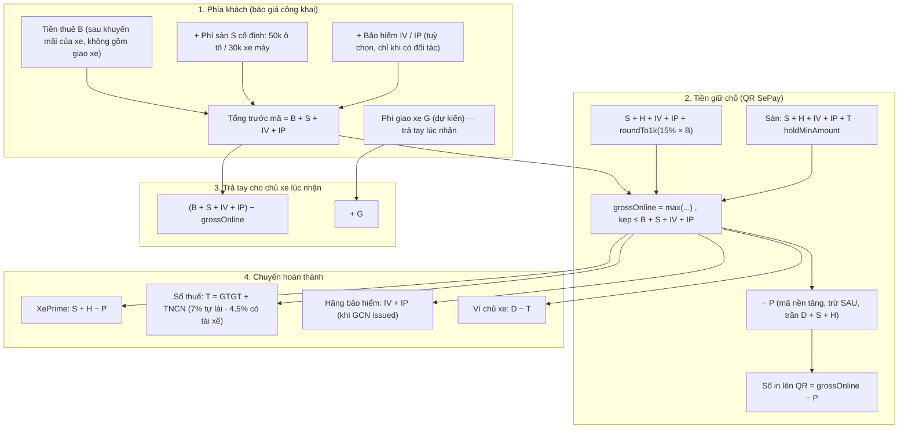
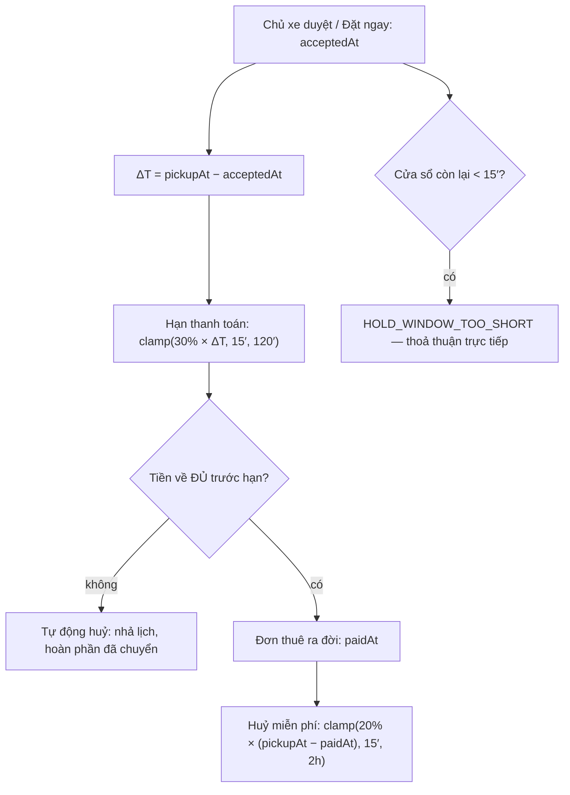

# BẢN THIẾT KẾ KỸ THUẬT TỔNG THỂ LUỒNG TIỀN XEPRIME
### (XEPRIME MASTER FINANCIAL ARCHITECTURE SPECIFICATION — V2.3)

> **Trạng thái:** Đang triển khai (theo [ADR 0064](decisions/0064-financial-flow-v2.md) / [ADR 0065](decisions/0065-per-vehicle-type-shop-plans.md) / [ADR 0066](decisions/0066-hold-15-percent-dynamic-sla-and-handover-safeguards.md) / [ADR 0068](decisions/0068-platform-tax-withholding-nd117-nd68.md) / [ADR 0069](decisions/0069-money-rounding-exact-vnd.md))  
> **Phiên bản:** v2.4 — 22/10/2026: thuế khấu trừ theo loại dịch vụ giống Mioto, doanh nghiệp không khấu trừ (ADR 0068); tiền tính ra đúng tới đồng (ADR 0069) · v2.3: tiền giữ chỗ 15% tiền thuê, đền huỷ muộn trọn `D`, SLA động (ADR 0066)  
> **Nguồn sự thật:** ba ADR trên. Tài liệu này GIẢI THÍCH và cho ví dụ; khi lệch nhau, ADR thắng. Tiến độ ở [`completion-roadmap.md`](completion-roadmap.md).  
> **Phạm vi:** tính giá, tiền giữ chỗ online, phân bổ và giải ngân ví điểm, cửa sổ thanh toán/huỷ động, phí giao xe, bảo hiểm (MIC — chưa có hợp đồng) và gói gian hàng theo loại xe, trên ba site: **Khách** (`xeprime.vn`), **Partner** (`partner.xeprime.vn`), **Admin** (`admin.xeprime.vn`).

---

## 1. NGUYÊN TẮC THIẾT KẾ & KỶ LUẬT TIỀN TỆ

1. **Tiền đúng tới đồng; bước 1.000đ chỉ cho chính sách (ADR 0069).**
   - Lưu `Decimal(14, 2)` ở DB, chuỗi trong JSON (ADR 0007).
   - Khoản **tính ra từ tỷ lệ** (hoa hồng $H$, phần giữ chỗ 15%, GTGT, TNCN, phí giao xe theo km) làm tròn tới **đồng**: $\text{roundVnd}(x) = \text{Math.round}(x)$.
   - Khoản **giảm giá theo %** (khuyến mãi xe, ưu đãi dài hạn, mã nền tảng) làm tròn **lên** 1.000đ rồi mới kẹp trần — khách không bao giờ được giảm ít hơn % đã công bố.
   - Số **cấu hình** trong `fee_policies` (phí sàn, biểu phí bảo hiểm, các sàn) là bội 1.000đ (CHECK `fee_policies_v2_amounts_thousand_step_check`) — chính sách hạn chế lẻ từ nguồn.
2. **Năm đẳng thức bảo toàn** (với $G$ là phí giao xe, $P$ là mã khuyến mãi nền tảng):
   $$\begin{aligned}
   \text{Tổng khách trả} &= B + S + IV + IP + G - P \\
   D &= \text{grossOnline} - S - H - IV - IP \\
   \text{Trả tay khi nhận xe} &= (B + S + IV + IP) - \text{grossOnline} + G \\
   \text{Ví chủ xe khi chuyến xong} &= D - T \\
   \text{Chủ xe nhận cho tiền thuê} &= B - H - T
   \end{aligned}$$
3. **Snapshot thương mại (ADR 0024).** Toàn bộ breakdown + phiên bản chính sách đóng băng lúc chuyến được NHẬN (ADR 0044). Admin sửa chính sách sau đó không hồi tố. Đơn tạo trước chính sách v7 giữ snapshot cũ.
4. **Tách quỹ đọc từ cột tiền.** `booking_holds` có năm cột `D`/`S`/`H`/`IV`/`IP` + `promo_discount_amount`; CHECK `D + S + H + IV + IP − P = amount`. Không hàm nào đọc `purpose` để quyết định tiền của ai (ADR 0033 điều 4).

---

## 2. CÔNG THỨC & CÁC DÒNG TIỀN CỐT LÕI

| Ký hiệu | Dòng | Ai trả | Ai hưởng | Qua XePrime? |
| :--- | :--- | :--- | :--- | :--- |
| $B$ | Tiền thuê (sau khuyến mãi trực tiếp của xe, **không gồm giao xe**) | Khách | Chủ xe | Một phần, qua $D$ |
| $S$ | Phí sàn (phí đặt xe) | Khách | XePrime | Có |
| $H$ | Hoa hồng lũy tiến (chỉ tuyến hoa hồng) | Chủ xe | XePrime | Có — trừ từ $D$ |
| $T$ | Thuế khấu trừ/nộp thay (GTGT + TNCN, theo loại dịch vụ — ADR 0068) | Chủ xe (cá nhân/hộ) | Ngân sách | Có — trừ từ $D$ |
| $IV$ · $IP$ | Bảo hiểm vật chất xe · tai nạn người (tuỳ chọn) | Khách | Hãng bảo hiểm | Có, giữ hộ |
| $G$ | Phí giao nhận xe | Khách | Chủ xe | **Không** |
| $P$ | Mã khuyến mãi nền tảng | XePrime tài trợ | Khách | Trừ vào QR |
| $D$ | Phần của chủ xe trong tiền giữ chỗ | — | Chủ xe | Có |

### 2.1. Phí sàn cố định phía khách ($S$ — `customerPlatformFee`)
- **Ô tô:** `50.000đ / đơn` · **Xe máy:** `30.000đ / đơn` (chính sách v7, dữ liệu admin sửa được).
- Như nhau cho đơn 1 ngày hay 30 ngày, và như nhau ở **cả hai tuyến**.

### 2.2. Hoa hồng lũy tiến theo ngày thuê ($H$ — `ownerCommissionTiers`)
Chỉ **tuyến hoa hồng**; tuyến gói $H = 0$ và không sinh dòng.

| Ngày thuê | % giá thuê của ngày đó |
| :--- | :--- |
| 1 – 2 | 10% |
| 3 – 7 | 7% |
| 8 – 30 | 3% |
| 31+ | 0% |

$H = \text{roundVnd}\Big(\sum_i \text{giá ngày}_i \times \%\text{nấc}(i)\Big)$$
Làm tròn **một lần** trên tổng (`computeTieredOwnerCommission`). Giao xe, bảo hiểm, $S$ không vào mẫu số.

### 2.3. Thuế ($T$)
- Khấu trừ, nộp thay theo **NĐ 117/2025 + NĐ 68/2026** (ADR 0068), mức theo **loại dịch vụ**, hai sắc thuế tính riêng (chính sách v9 — giống Mioto):

  | Dịch vụ | GTGT | TNCN | Tổng |
  | :--- | :---: | :---: | :---: |
  | Tự lái · Thuê dài hạn | 5% | 2% | **7%** |
  | Có tài xế | 3% | 1,5% | **4,5%** |
- Chỉ chủ thể **cá nhân / hộ kinh doanh**; gian hàng **doanh nghiệp** $T = 0$ (tự xuất hoá đơn). Tuyến hoa hồng hay gói KHÔNG quyết định thuế.
- **Cơ sở tính = $B$**, không gồm $G$, $S$, $IV$, $IP$. Mỗi sắc thuế làm tròn tới đồng: $T = \text{roundVnd}(B \times \text{GTGT\%}) + \text{roundVnd}(B \times \text{TNCN\%})$.
- Ghi sổ khi chuyến bắt đầu; huỷ trước chuyến không có thuế. Đặc tả đầy đủ + câu hỏi chờ tư vấn thuế: `docs/specifications/05-owner-tax-withholding-spec.md`.

### 2.4. Tiền giữ chỗ (khoản online qua QR) — ADR 0066 điều 1
$$D_{\text{target}} = \max\big(\text{roundVnd}(\text{depositPercent} \times B),\ \text{depositMinAmount}\big) \qquad (15\%\ \text{và sàn}\ 0\ \text{ở chính sách v8})$$
$$\text{grossOnline} = \min\Big(B{+}S{+}IV{+}IP,\ \max\big(S{+}H{+}IV{+}IP{+}D_{\text{target}},\ S{+}H{+}IV{+}IP{+}T,\ \text{holdMinAmount}\big)\Big)$$
- Tiền giữ chỗ = mọi thứ KHÔNG phải tiền chủ xe ($S + H + IV + IP$) + **phần cam kết giữ xe của chủ xe** $15\% \times B$. `depositPercent` là % của **tiền thuê $B$** (không gồm $G$), không còn là % của tổng khách trả.
- Sàn $S + H + IV + IP + T$ bảo đảm $D \ge T$ — ví chủ xe không bao giờ nhận khoản âm (CHECK `deposit_percent ≥ tax_percent` giữ nó ở phía cấu hình).
- Tuyến gói **tắt** công tắc thu cọc: $\text{grossOnline} = \max(S + IV + IP + T,\ \text{holdMinAmount})$, kẹp như trên.
- Báo giá tạm tính / dài hạn chưa chốt lịch ⇒ không thu online, không có QR.
- Giao diện luôn gọi là **"tiền giữ chỗ"**, không bao giờ "cọc" (ADR 0044 điều 9).

### 2.5. Thứ tự áp mã khuyến mãi
1. Tính `grossOnline` **không mã** (công thức và các sàn ở 2.4).
2. Trừ $P$: $\text{QR} = \text{grossOnline} - P$, với $P \le \min(\text{trần của mã},\ \text{tiền thuê đủ điều kiện},\ \text{grossOnline} - \text{holdMinAmount},\ D + S + H)$.
3. $B$, $S$, $H$, $T$, $IV$, $IP$, $D$, phần trả tay và ví chủ xe **không đổi**; XePrime gánh $P$ (doanh thu $S + H - P$ có thể âm).

---

## 3. XE CÓ TÀI XẾ & PHÍ GIAO XE TẬN NƠI

### 3.1. Xe có tài xế
- Ba ô giá trên từng xe: `withDriverDailyPrice` (nội thành), `withDriverInterCityPrice` (liên tỉnh 2 chiều), `withDriverOneWayPrice` (liên tỉnh 1 chiều).
- Phụ phí tài xế theo quy tắc (`DRIVER_SURCHARGE_KIND`): ngoài giờ, chờ đợi, quá km, lưu đêm.
- Tiền tài xế nằm trong $B$ ⇒ chịu $H$ (tuyến hoa hồng) và $T$ như tiền thuê; $S$ vẫn cố định; phần giữ chỗ của chủ xe vẫn 15% × $B$.
- Tài xế là tài khoản khách được bên thuê mời liên kết (ADR 0063). Tài xế có $\text{clamp}(10\% \times \Delta T, 15′, 60′)$ (với $\Delta T$ = `pickupAt` − lúc gán) để nhận/từ chối; quá hạn ⇒ worker nhả lượt gán và báo khẩn gian hàng gán người khác trong 30 phút — đơn của khách không bị huỷ (ADR 0066 điều 4).
- **Tài xế ngoài hệ thống** (ADR 0067): bên thuê ghi tên + SĐT tài xế thuê ngoài trên đúng đơn đó — không cần tài khoản, coi là đã nhận ngay, khách thấy như tài xế liên kết. Không chống trùng lịch, không vào thống kê/thù lao tài xế.
- **Thiếu tài xế sát giờ KHÔNG tự huỷ** (ADR 0067): còn 2 giờ mà chưa có ai (không lượt gán nào, không tài xế ngoài) ⇒ worker nhắc khẩn bên thuê một lần. Không đồng tiền nào đổi chiều; sau giờ nhận dựa vào lưới §7.4; bên thuê không phục vụ được thì tự huỷ chuyến (hoàn 100%, ghi trách nhiệm).

### 3.2. Phí giao nhận xe ($G$) — theo Wave 9
- **Không nằm trong tiền giữ chỗ.** Chủ xe chốt phí đã thoả thuận **sau khi duyệt**; khách trả **trực tiếp chủ xe lúc nhận xe**. XePrime không thu hộ, không đối soát.
- Không vào cơ sở 15%, không chịu $H$, không chịu $T$, không đủ điều kiện mã khuyến mãi. Chủ xe hưởng 100%.
- Báo giá cho khách hiện $G$ là dòng *dự kiến, trả khi nhận xe* khi có ước lượng khoảng cách (ADR 0018/0061).
- Bảng bậc `deliveryTiers` của chính sách cho thuê có **hai dạng loại trừ nhau**:
  - Trọn gói `{ toKm, fee }` — ví dụ ≤ 5 km: 0đ; ≤ 10 km: 100.000đ.
  - **Theo km** `{ toKm, perKm }` — phí = `perKm` × khoảng cách, đúng tới đồng (ADR 0069) — ví dụ ≤ 15 km: 10.000đ/km.

---

## 4. QUẢN TRỊ THÙ LAO TÀI XẾ — **HOÃN**

Thù lao/công nợ tài xế trong Manage (khoán theo cuốc, chia %, lương biên chế, phiếu chi `driver_wage`) **không thuộc đợt này**. Quyết định 21/10/2026: làm ở giai đoạn sau, **chỉ cho tuyến gói**, và cần **ADR riêng** (nó chạm sổ thu chi của gian hàng, không chạm đường tiền qua XePrime). Không có màn hình, bảng hay endpoint nào cho phần này ở thời điểm hiện tại.

---

## 5. BẢNG PHÂN BỔ DÒNG TIỀN (VÍ DỤ CHUẨN)

*Kịch bản: ô tô 5 ngày × 1.000.000đ/ngày, giao xe tận nơi 200.000đ (trả tay), thuế tự lái 7% (GTGT 5% + TNCN 2%) trên tiền thuê, chủ xe cột 1–2 là cá nhân, gian hàng cột 3 là hộ kinh doanh, chính sách v8 (`depositPercent` 15% tiền thuê, sàn cọc 0, `holdMinAmount` nhỏ hơn mọi số dưới đây nên không chạm). Không mã khuyến mãi.*

Hoa hồng 5 ngày (tuyến hoa hồng): $2 \times 1.000.000 \times 10\% + 3 \times 1.000.000 \times 7\% = 200.000 + 210.000 = 410.000$đ.
Thuế: $T = 5\% \times 5.000.000 + 2\% \times 5.000.000 = 250.000 + 100.000 = 350.000$đ (không tính trên 200.000đ giao xe).

| Mục | Công thức | 1. Hoa hồng · không bảo hiểm | 2. Hoa hồng · có IV 50k/ngày | 3. Tuyến gói · cọc bật |
| :--- | :--- | :--- | :--- | :--- |
| **Tiền thuê ($B$)** | 1.000.000 × 5 | `5.000.000đ` | `5.000.000đ` | `5.000.000đ` |
| **Phí sàn ($S$)** | cố định ô tô | `+ 50.000đ` | `+ 50.000đ` | `+ 50.000đ` |
| **Bảo hiểm ($IV + IP$)** | chỉ khi có đối tác | `0đ` | `+ 250.000đ` *(50.000 × 5)* | `0đ` |
| **Tổng trước mã** | $B + S + IV + IP$ | `5.050.000đ` | `5.300.000đ` | `5.050.000đ` |
| **Phí giao xe ($G$)** | trả tay, ngoài tiền giữ chỗ | `+ 200.000đ` | `+ 200.000đ` | `+ 200.000đ` |
| **Tổng khách trả** | + $G$ | **`5.250.000đ`** | **`5.500.000đ`** | **`5.250.000đ`** |
| Hoa hồng ($H$) | lũy tiến trên $B$ | `410.000đ` | `410.000đ` | `0đ` |
| Phần giữ chỗ của chủ xe | roundVnd(15% × $B$) | `750.000đ` | `750.000đ` | `750.000đ` |
| Sàn không-phải-tiền-chủ-xe | $S + H + IV + IP + T$ | `810.000đ` *(50k + 410k + 350k)* | `1.060.000đ` *(50k + 410k + 250k + 350k)* | `400.000đ` *(50k + 0 + 350k)* |
| **Tiền giữ chỗ (QR)** | max($S + H + IV + IP$ + 15%·$B$, sàn) | **`1.210.000đ`** *(50k + 410k + 750k)* | **`1.460.000đ`** *(50k + 410k + 250k + 750k)* | **`800.000đ`** *(50k + 750k)* |
| **Trả tay lúc nhận xe** | tổng trước mã − QR + $G$ | **`4.040.000đ`** *(3.840.000 + 200.000)* | **`4.040.000đ`** *(3.840.000 + 200.000)* | **`4.450.000đ`** *(4.250.000 + 200.000)* |
| Thuế ($T$) | GTGT 5% + TNCN 2% × $B$ | `350.000đ` | `350.000đ` | `350.000đ` |
| $D$ (phần chủ xe trong QR) | QR − $S$ − $H$ − $IV$ − $IP$ | `750.000đ` | `750.000đ` | `750.000đ` |
| **XePrime giữ** | $S + H$ | `460.000đ` | `460.000đ` | `50.000đ` |
| **Giữ hộ hãng bảo hiểm** | $IV + IP$ | `0đ` | `250.000đ` | `0đ` |
| **Nộp ngân sách** | $T$ | `350.000đ` | `350.000đ` | `350.000đ` |
| **Ghi có ví chủ xe** | $D - T$ | **`400.000đ`** | **`400.000đ`** | **`400.000đ`** |
| Chủ xe nhận cho tiền thuê | trả tay (phần thuê) + ví = $B - H - T$ | `4.240.000đ` *(3.840.000 + 400.000)* | `4.240.000đ` *(3.840.000 + 400.000)* | `4.650.000đ` *(4.250.000 + 400.000)* |
| **Chủ xe THỰC NHẬN** | + $G$ | **`4.440.000đ`** | **`4.440.000đ`** | **`4.850.000đ`** |

**Kiểm tra bảo toàn** (tổng khách trả = chủ xe + XePrime + bảo hiểm + thuế):
- Cột 1: $4.440.000 + 460.000 + 0 + 350.000 = 5.250.000$ ✓ · khách: $1.210.000 + 4.040.000 = 5.250.000$ ✓
- Cột 2: $4.440.000 + 460.000 + 250.000 + 350.000 = 5.500.000$ ✓ · khách: $1.460.000 + 4.040.000 = 5.500.000$ ✓
- Cột 3: $4.850.000 + 50.000 + 0 + 350.000 = 5.250.000$ ✓ · khách: $800.000 + 4.450.000 = 5.250.000$ ✓ · *Nếu gian hàng là doanh nghiệp: $T = 0$, ví nhận trọn $D = 750.000$đ.*

**Biến thể:**
- *Cột 3, gian hàng TẮT thu cọc:* QR = $\max(S + T, \text{holdMin}) = 400.000$đ; $D = 350.000$đ; ví $= D - T = 0$đ; trả tay $= 5.050.000 - 400.000 + 200.000 = 4.850.000$đ; chủ xe vẫn nhận $4.650.000$đ tiền thuê ($B - T$).
- *Cột 1 với mã 100.000đ:* QR $= 1.210.000 - 100.000 = 1.110.000$đ; tổng khách $5.150.000$đ; trả tay, $D$, ví chủ xe **không đổi**; XePrime giữ $S + H - P = 360.000$đ.
- *Xe máy 1 ngày 150.000đ, tuyến hoa hồng, không bảo hiểm:* $S = 30.000$, $H = 15.000$, $15\% \times B = 22.500$ (đúng tới đồng, không làm tròn), $T = 7.500 + 3.000 = 10.500$ ⇒ QR $= 67.500$đ, $D = 22.500$đ, ví chủ xe khi chuyến xong $= 12.000$đ.

Báo giá công khai chỉ hiện các dòng phía khách (tiền thuê, phí sàn, bảo hiểm, giao xe dự kiến, tiền giữ chỗ, phần trả khi nhận). Hoa hồng, thuế, $D$, ví chủ xe chỉ hiện ở bề mặt đối tác và quản trị (ADR 0064 điều 11).

---

## 6. DANH MỤC 7 GÓI THUÊ BAO GIAN HÀNG (ADR 0065)

Gian hàng giữ **tối đa một gói xe máy VÀ một gói ô tô** cùng lúc; `enterprise_contact` loại trừ cả hai. Trần đếm **theo loại xe** trong phạm vi của từng gói. Có một gói hiện hành bất kỳ ⇒ **cả gian hàng** ở tuyến gói (0% hoa hồng, Full Manage). Loại xe không có gói ⇒ không tạo được, không gửi chợ được — **không rơi về hoa hồng**. Không còn trần chi nhánh.

| Mã gói | Phạm vi | Trần xe | Hoa hồng | Giá |
| :--- | :--- | :--- | :--- | :--- |
| `moto_1` | Xe máy | 1 | **0%** | Số tuyệt đối từng kỳ 1/3/6/12 tháng, admin nhập |
| `moto_5` | Xe máy | 5 | **0%** | như trên |
| `moto_10` | Xe máy | 10 | **0%** | như trên |
| `car_1` | Ô tô | 1 | **0%** | như trên |
| `car_5` | Ô tô | 5 | **0%** | như trên |
| `car_10` | Ô tô | 10 | **0%** | như trên |
| `enterprise_contact` | Cả hai | Không giới hạn | **0%** | Bán bằng tư vấn — admin gán, giá đàm phán bắt buộc |

Bảo đảm ở DB: không hai kỳ gói chồng nhau trên cùng (tenant, phạm vi); `all` chồng được với cả `car` lẫn `motorbike` nên bị loại trừ; một hoá đơn mở mỗi (tenant, phạm vi). Thuê bao `shop-basic`/`shop-advanced` hiện có được chuyển **miễn phí** sang cặp bậc nhỏ nhất vừa đội xe từng loại (loại > 10 xe ⇒ `enterprise_contact`), giữ ngày hết hạn; `shop-pro` ⇒ `enterprise_contact`.

---

## 7. SLA ĐỘNG: PHẢN HỒI, THANH TOÁN & HUỶ MIỄN PHÍ (ADR 0066 điều 3)

Bốn đồng hồ cùng một hình dạng $\text{clamp}(\text{round}(\Delta T \times \text{tỉ lệ}),\ \text{sàn},\ \text{trần})$; server lưu mốc, client chỉ đọc.

| Đồng hồ | $\Delta T$ | Công thức | Hết hạn |
| :--- | :--- | :--- | :--- |
| Chủ xe phản hồi yêu cầu | `pickupAt − createdAt` | 240′ nếu $\Delta T \ge 24$h; ngược lại clamp(20%, 15′, 240′); dài hạn chưa có giờ nhận ⇒ 240′ | `expired`, tính vào tỉ lệ phản hồi |
| Khách trả tiền giữ chỗ $T_{\text{pay}}$ | `pickupAt − acceptedAt` | clamp(30%, 15′, 120′) | **tự động huỷ**: `hold_expired`, nhả lịch, hoàn phần đã chuyển |
| Huỷ miễn phí $T_{\text{cancel}}$ | `pickupAt − paidAt` (tiền về ĐỦ — ADR 0072) | clamp(20%, 15′, 2h) | qua mốc ⇒ huỷ muộn (§7.3) |
| Tài xế nhận cuốc | `pickupAt − lúc gán` | clamp(10%, 15′, 60′) | nhả lượt gán + báo khẩn gian hàng (§3.1) |

Hạn thanh toán tính **xuôi từ `acceptedAt`**, kẹp bởi `pickupAt` (`holdWindowsFor`), lưu lúc tạo hold. Mốc huỷ miễn phí tính **xuôi từ `paidAt`** với ΔT = `pickupAt − paidAt` (`freeCancelWindowFromPayment`), ghi MỘT lần trong lượt lật hold sang `paid` — `free_cancel_until` NULL tới lúc đó (ADR 0072). Trước khi trả đủ không có huỷ miễn phí: chưa có đơn, khách chưa mất đồng nào, hết hạn là tự huỷ. Không gia hạn; nhắc ở mốc còn 60′ và 15′ (mốc nào dài hơn cả cửa sổ thì bỏ qua). Hạn phản hồi của yêu cầu lưu ở `booking_requests.respond_by` lúc gửi; worker nhắc chủ xe theo phần còn lại, cũng ở 60′ và 15′.

### 7.1. Công thức
$$T_{\text{pay}} = \min\big(120,\ \max(15,\ \text{round}(\Delta T \times 30\%))\big)\ \text{phút}
\qquad
T_{\text{cancel}} = \min\big(120,\ \max(15,\ \text{round}(\Delta T_{\text{paid}} \times 20\%))\big)\ \text{phút}$$

$\Delta T$ của $T_{\text{pay}}$ là `pickupAt − acceptedAt`; $\Delta T_{\text{paid}}$ của $T_{\text{cancel}}$ là `pickupAt − paidAt` (ADR 0072). Trần là dữ liệu chính sách (`holdPaymentWindowMinutes` = 120′, `freeCancelHours` = 2h ở v8). Luôn có tối thiểu 15′ huỷ miễn phí sau khi trả (vẫn kẹp bởi `pickupAt`). Huỷ miễn phí bắt đầu khi tiền về đủ, nên không còn ca "khách trả ở cuối hạn đã qua mốc huỷ miễn phí" của ADR 0066: màn thanh toán chỉ nói trước độ dài cửa sổ ("Huỷ miễn phí: N kể từ lúc thanh toán thành công"), đồng hồ huỷ miễn phí chỉ chạy sau khi trả.

### 7.2. Bảng tình huống

| Tình huống | $\Delta T$ (lúc nhận / lúc trả) | Huỷ miễn phí (từ lúc trả) | Hạn thanh toán (từ lúc nhận) | Khách huỷ sau mốc miễn phí (trước bàn giao) |
| :--- | :--- | :--- | :--- | :--- |
| Đặt trước 3 ngày | 72 giờ | **2 giờ** | **120 phút** | chủ xe nhận trọn $D$; XePrime giữ $S + H - P$; $IV + IP$ hoàn 100% |
| Đặt trước 1 ngày | 24 giờ | **2 giờ** | **120 phút** | như trên |
| Đặt trước 10 tiếng | 10 giờ | **2 giờ** (600′ × 20%) | **120 phút** (600′ × 30% = 180′, kẹp 120′) | như trên |
| Đặt trước 4 tiếng, trả sau 60′ | 240′ / 180′ | **36 phút** (180′ × 20%) | **72 phút** | như trên — mốc tính từ lúc trả, không còn "đã qua mốc trước khi trả" |
| Đặt gấp trước 90 phút, trả ngay | 1,5 giờ | **18 phút** | **27 phút** | như trên |
| Đặt gấp trước 30 phút | 30′ | **15 phút** (sàn) | **15 phút** (sàn) | như trên |
| Giờ nhận còn dưới 15′ | < 15′ | — | — | Không phát QR: `HOLD_WINDOW_TOO_SHORT` |
| Hết hạn thanh toán mà chưa đủ tiền | — | — | — | **Tự động huỷ**: nhả lịch, hoàn phần đã chuyển vào Ví điểm, báo hai bên |

### 7.3. Phân bổ khi huỷ (theo ví dụ §5) — ADR 0066 điều 2

| Sự kiện | Cột 1 | Cột 2 | Cột 3 |
| :--- | :--- | :--- | :--- |
| Huỷ muộn / no-show → ví chủ xe (trọn $D$) | `750.000đ` | `750.000đ` | `750.000đ` |
| → XePrime ($S + H - P$) | `460.000đ` | `460.000đ` | `50.000đ` |
| → ví khách ($IV + IP$) | `0đ` | `250.000đ` | `0đ` |
| Huỷ trong mốc miễn phí / chủ xe huỷ → ví khách | `1.210.000đ` | `1.460.000đ` | `800.000đ` |

Hoàn toàn bộ chỉ hoàn **đúng số khách đã chuyển** (không hoàn phần $P$ nền tảng tài trợ). Tiền hoàn luôn vào ví **tài khoản khách** (ADR 0053 điều 8). Thuế không phát sinh ở mọi nhánh huỷ: khoản đền cho chủ xe là bồi thường vi phạm, không phải doanh thu cho thuê. Chủ xe / gian hàng huỷ còn bị ghi trách nhiệm vào chỉ số uy tín (ADR 0045).

### 7.4. Mốc nhận xe — lưới chống treo đơn (ADR 0066 điều 5)

Không có trạng thái đơn mới. Chủ xe xác nhận giao xe ⇒ đơn `active` ngay (thuế, bảo hiểm khởi động); ảnh hiện trạng và số công tơ mét **tuỳ chọn**, có lời khuyến nghị chụp, và hiện ở trang chuyến của khách.
- **Khách báo "Chưa nhận được xe"** trong `[pickupAt, pickupAt + 120′]` (đơn `reserved` hoặc `active`) ⇒ mở hồ sơ hỗ trợ `dispute` ưu tiên khẩn; hồ sơ tranh chấp đang mở **hoãn quyết toán** tiền giữ chỗ cho tới khi CSKH xử lý.
- **Cả hai im lặng:** quá `pickupAt + 120′` mà đơn vẫn `reserved`, chưa có biên bản nhận xe ⇒ worker mở hồ sơ `handover_unconfirmed` cho CSKH gọi xác minh; hồ sơ này cũng hoãn quyết toán, nên một no-show ghi sau đó không tự chuyển tiền.

---

## 8. BẢO HIỂM MIC — THIẾT KẾ & GIẢ LẬP

### 8.1. Cổng thu phí (ADR 0064 điều 10)
- $IV$ và $IP$ **đều tuỳ chọn**, mặc định **không** chọn, khách tự tích.
- Server chỉ cộng phí khi **(a)** dòng chính sách bật **và (b)** `INSURANCE_PARTNER` khác `none`. Thiếu một trong hai: không cộng dù client gửi lựa chọn; giao diện **ẩn hẳn** hai ô tích.
- **Production:** `INSURANCE_PARTNER = none` cho tới khi có hợp đồng + adapter thật ⇒ không ô tích, không thu đồng nào. `mic_mock` bị env schema từ chối boot ở production.
- **Dev/staging:** `INSURANCE_PARTNER = mic_mock` ⇒ `MicMockInsurancePartner` phát GCN giả lập qua worker ở mốc bàn giao; mọi GCN phải mang nhãn **TEST** và không có hiệu lực bảo hiểm.
- Phát hành chỉ ở bàn giao/bắt đầu chuyến, job idempotent có retry, không gọi HTTP đối tác trong transaction DB. Huỷ trước nhận xe ⇒ hoàn 100% $IV + IP$.

### 8.2. Danh mục sản phẩm (bản nháp — chờ hợp đồng MIC xác nhận)
Mô tả sản phẩm sống ở **màn danh mục sản phẩm MIC** của admin (đang làm); biểu phí ngày sống ở `fee_policies` (có phiên bản).

| Tiêu chí | Vật chất xe ($IV$) | Tai nạn người trên xe ($IP$) |
| :--- | :--- | :--- |
| Phạm vi bảo vệ (nháp) | Đâm va, lật đổ, chìm, rơi, hoả hoạn, ngập nước, mất cắp bộ phận | Tử vong, thương tật do tai nạn khi lưu hành trên xe thuê |
| Mức bồi thường tối đa (nháp) | Giá trị thực tế của xe | Ô tô `50.000.000đ/người/vụ` · Xe máy `20.000.000đ/người/vụ` |
| Mức khấu trừ (nháp) | Ô tô `2.000.000đ/vụ` · Xe máy `500.000đ/vụ` | Không |
| Biểu phí ngày — ô tô (v7) | `50.000đ/ngày` | `20.000đ/ngày` |
| Biểu phí ngày — xe máy (v7) | `15.000đ/ngày` | `5.000đ/ngày` |
| Tiền tố GCN giả lập | `MIC-VCX-…` | `MIC-NNTX-…` |

### 8.3. Adapter giả lập (`MicMockInsurancePartner`)
- Số GCN suy tất định từ `idempotencyKey` — worker thử lại nhận đúng số cũ.
- Khi có hợp đồng: viết adapter thật cạnh adapter giả lập, đổi nhánh trong `InsuranceModule`; `InsuranceService` và luồng kế toán không đổi.
- **Còn phải sửa:** số GCN giả lập chưa mang nhãn TEST, và URL tra cứu đang trỏ một tên miền của MIC (`staging-cert.mic.vn`) — phải thay bằng mẫu URL từ danh mục sản phẩm / trang GCN TEST do XePrime tự phục vụ.

---

## 9. MA TRẬN GIAO DIỆN TRÊN 3 SITE

### 9.1. Site khách (`xeprime.vn`)
1. **Trang xe `/listings/[id]`** — `ListingBookingCard`: báo giá tạm tính (giá ngày, phí sàn, phí giao xe dự kiến theo địa chỉ, ô tích bảo hiểm **chỉ khi cổng mở**, tiền giữ chỗ và phần trả khi nhận).
2. **Gửi yêu cầu** — `RequestBookingModal` / `RequestBookingFlow` + `BookingReviewCosts`: tóm tắt chi phí, tách **"Tiền giữ chỗ (sau khi được duyệt)"** và **"Trả chủ xe khi nhận xe"**. Gửi yêu cầu không thu tiền (ADR 0044).
3. **Thanh toán tiền giữ chỗ ở `/trips/[id]`** — `TripPaymentCheckout`: VietQR SePay đúng số tiền, đồng hồ $T_{\text{pay}}$ đọc từ `expires_at`, mốc huỷ miễn phí đọc từ `free_cancel_until`; tự lật khi tiền về (không có nút "Tôi đã chuyển khoản").
4. **`/trips` · `/trips/[id]`** — tiền giữ chỗ đã trả, phần còn trả khi nhận xe, GCN bảo hiểm sau bàn giao (nếu có).

### 9.2. Site partner (`partner.xeprime.vn`)
1. **Hộp thư yêu cầu `/booking-requests`** — `ApproveBookingRequestDialog`: tiền giữ chỗ khách sẽ chuyển, tiền thu tại chỗ, hoa hồng, thuế, số sẽ vào ví điểm; cửa sổ thanh toán/huỷ dự kiến theo $\Delta T$.
2. **Chi tiết đơn `/bookings/[id]`** — tóm tắt tài chính chuyến, nhập phí giao xe đã thoả thuận.
3. **Ví điểm `/balance`** — ghi có $D - T$ khi chuyến xong, trọn $D$ khi khách huỷ muộn / no-show; yêu cầu rút về tài khoản ngân hàng.
4. **Gói thuê bao `/subscription`** (+ onboarding tuyến gói) — chọn tối đa một bậc mỗi loại xe; `enterprise_contact` là thẻ "Liên hệ tư vấn".

*(URL hiển thị không mang tiền tố `/manage`; thư mục nội bộ là `app/(manage)/manage/*` — ADR 0051.)*

### 9.3. Site admin (`admin.xeprime.vn`)
1. **Chính sách phí `/fee-policies`** — bản v2: hai ô $S$, bảng nấc $H$, % tiền giữ chỗ + sàn, thuế, biểu phí bảo hiểm theo ngày *(form v2 đang làm)*.
2. **Gói `/plans`** — bảy bậc, giá tuyệt đối từng kỳ; gán gói cho gian hàng theo phạm vi.
3. **Tài chính `/money`** — `FinanceView`: giữ chỗ (holds) và quyết toán, hoàn tiền, yêu cầu rút, đơn cổng thanh toán, **tab Bảo hiểm** (hàng đợi chứng nhận).
4. **Mã khuyến mãi `/promo-codes`** · **Giao dịch ngân hàng `/bank-transactions`**.
5. **Danh mục sản phẩm MIC** — *đang làm*.

---

## 10. TIẾN ĐỘ — DANH SÁCH TRUNG THỰC

Rà soát 21/10/2026. Bản trước của mục này ghi "đã triển khai & nghiệm thu" kèm số test; các con số đó **không được kiểm chứng lại** ở lần rà soát này và không được dùng làm bằng chứng.

**Đã có trong code** (commit `a140472f`, migration `20261020170000_financial_flow_v2`, chính sách phí v7):
- [x] `@xeprime/types`: `computeCustomerFees` (phí sàn cố định, hoa hồng lũy tiến, tiền giữ chỗ có sàn — từ 22/10 là `S + H + IV + IP + 15% × B` theo ADR 0066, trần mã `D + S + H`), `computeTieredOwnerCommission`, `roundToThousand`, `resolveHoldAllocation` với dòng $H$, `holdWindowsFor` (cửa sổ động).
- [x] DB: cột v2 trên `fee_policies`, `booking_holds.owner_commission_amount` + bốn CHECK viết lại, `bookings.owner_commission_amount`, lựa chọn bảo hiểm trên `booking_requests`.
- [x] `MicMockInsurancePartner` + chặn `mic_mock` ở production trong env schema.
- [x] Web: `ListingBookingCard`, `RequestBookingFlow`/`BookingReviewCosts`, `ApproveBookingRequestDialog` đọc breakdown v2.

**Đang làm:**
- [ ] Bỏ phí giao xe khỏi cơ sở thuế (code hiện vẫn tính).
- [ ] Gỡ trường phía chủ xe (`ownerCommissionAmount`, `ownerNetAmount`, `ownerPayableAmount`, `platformRetainedAmount`, `taxAmount`) khỏi báo giá công khai — web + mobile.
- [ ] Cổng `INSURANCE_PARTNER` cho $IV$/$IP$ ở server + ẩn ô tích khi đóng; nhãn TEST và URL GCN không dùng tên miền MIC.
- [ ] Form admin chính sách phí v2; màn danh mục sản phẩm MIC; hàng đợi chứng nhận.
- [ ] Bậc giao xe theo km (dạng `{ toKm, perKm }` đã có trong types; còn form + hiển thị).
- [ ] Gói theo loại xe (ADR 0065): backend (phạm vi, EXCLUDE, hoá đơn mở theo phạm vi, chuyển đổi miễn phí) + web (`/subscription`, onboarding, admin gán gói).
- [ ] UX cửa sổ động và huỷ: hiện mốc huỷ miễn phí trước khi trả, câu chữ cho $\Delta T < 2$ giờ.
- [ ] ADR 0066 (22/10/2026): chính sách v8 (15% tiền thuê, sàn cọc 0, huỷ miễn phí tối đa 2h), đền huỷ muộn trọn $D$, SLA phản hồi động cho chủ xe và tài xế, nút "Chưa nhận được xe" + hồ sơ `handover_unconfirmed` — đang triển khai trên nhánh hiện tại; trạng thái nghiệm thu ghi ở `completion-roadmap.md`, không ở đây.
- [ ] ADR 0068 + 0069: thuế theo loại dịch vụ (GTGT/TNCN riêng, doanh nghiệp miễn), tiền đúng tới đồng, bảng cộng ví chủ xe, văn bản Chính sách thuế — đang triển khai.
- [ ] ADR 0067: tài xế ngoài hệ thống trên đơn + nhắc khẩn thiếu tài xế ở mốc 2 giờ (không tự huỷ) — đang triển khai.

**Hoãn / chưa thuộc đợt này:**
- [ ] App native (khách + Partner) theo v2 và gói theo loại xe — việc của đội mobile.
- [ ] Thù lao tài xế (§4) — giai đoạn sau, tuyến gói, cần ADR riêng.
- [ ] Release gate ADR 0028: tư vấn thuế cho phân loại và mức khấu trừ (ADR 0068 — đang áp theo Mioto), hợp đồng MIC thật, ý kiến pháp lý thu hộ — không mở được bằng mã.
