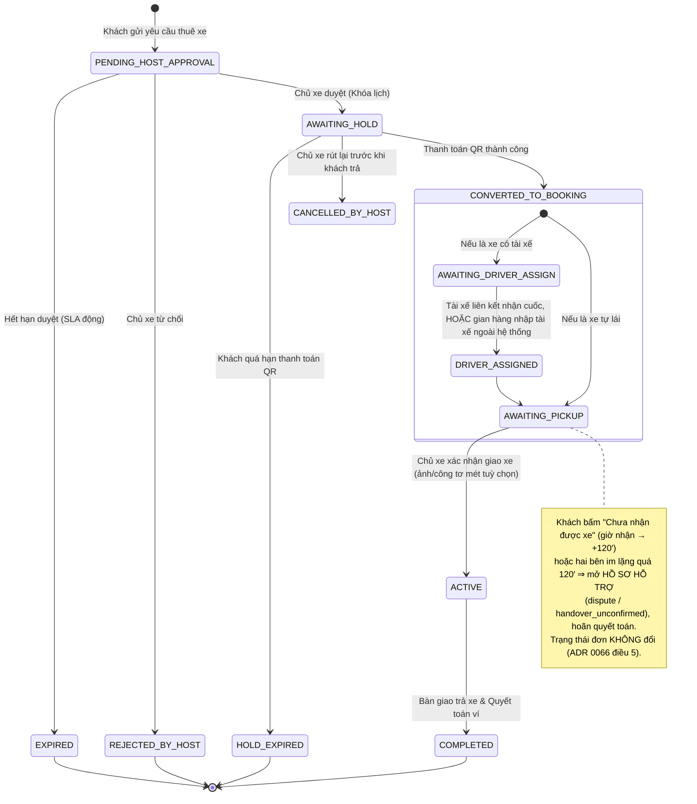

# TÀI LIỆU ĐẶC TẢ LUỒNG ĐẶT XE, SLA ĐỘNG & BÀN GIAO XE (BOOKING LIFECYCLE & HANDOVER SPEC)

| Thông tin tài liệu | Chi tiết |
| :--- | :--- |
| **Mã tài liệu** | `SPEC-BUS-02` |
| **Dự án** | XePrime Rental Platform |
| **Phiên bản** | `v3.1.0` — 22/10/2026: khớp ADR 0066 (không thêm trạng thái đơn) và ADR 0067 (tài xế ngoài hệ thống, không tự huỷ) |
| **Ngày ban hành** | 22/10/2026 |
| **Module liên quan** | `booking-requests`, `holds`, `bookings`, `handovers`, `customer-trips` |

---

## 1. SƠ ĐỒ TRẠNG THÁI TOÀN TRÌNH (STATE MACHINE)



> **Ánh xạ sang trạng thái thật trong code:** `AWAITING_PICKUP` = đơn `reserved`, `ACTIVE` = đơn `active` (không có `IN_PROGRESS`). Tranh chấp và "chờ xác nhận bàn giao" KHÔNG là trạng thái đơn mà là hồ sơ hỗ trợ (ADR 0066 điều 5). Hai chặng tài xế là trạng thái của LƯỢT GÁN, không phải của đơn.

---

## 2. MA TRẬN SLA & CỬA SỔ THỜI GIAN CO GIÃN ĐỘNG (DYNAMIC WINDOWS)

Gọi $\Delta T = \text{pickupAt} - \text{createdAt}$ (Khoảng cách thời gian từ lúc tạo yêu cầu đến giờ giao nhận xe).

### 2.1. Chặng 1: SLA Chủ xe duyệt yêu cầu
Thay thế thời gian 60 phút cố định bằng công thức động:
$$T_{\text{approve}} = \begin{cases}
240\text{ phút (4 giờ)} & \Delta T \ge 24\text{ giờ} \\
\min\big(240,\ \max(15,\ \text{round}(\Delta T \times 20\%))\big)\text{ phút} & \Delta T < 24\text{ giờ}
\end{cases}$$

*Quy tắc nghiệp vụ:*
- **Sàn tối thiểu:** Luôn bảo đảm chủ xe có ít nhất **15 phút** để phản hồi.
- **Xử lý khi quá hạn (Timeout):**
  1. Worker chuyển trạng thái `BookingRequest` thành `expired`.
  2. Hệ thống trừ điểm **Tỷ lệ phản hồi (Response Rate)** của chủ xe.
  3. Gửi Push Notification cho khách: *"Chủ xe chưa kịp duyệt yêu cầu. Bấm vào đây để xem các xe tương tự đang sẵn sàng quanh bạn."*

---

### 2.2. Chặng 2: SLA Khách thanh toán tiền giữ chỗ ($T_{\text{pay}}$)
$$T_{\text{pay}} = \begin{cases}
120\text{ phút (2 giờ)} & \Delta T \ge 24\text{ giờ} \\
\min\big(120,\ \max(15,\ \text{round}(\Delta T \times 30\%))\big)\text{ phút} & \Delta T < 24\text{ giờ}
\end{cases}$$

*Quy tắc nghiệp vụ:*
- Trong thời gian $T_{\text{pay}}$, xe được khóa lịch trên chợ (`awaiting_hold`), các khách khác không thể đặt trùng khung giờ này (`SLOT_TAKEN`).
- Quá hạn $T_{\text{pay}}$ mà SePay chưa ghi nhận đủ tiền ⇒ **tự động huỷ**: hold `expired`, yêu cầu `hold_expired`, nhả lịch xe ngay lập tức, nhả lượt mã khuyến mãi, hoàn phần đã chuyển (nếu có) vào Ví điểm, báo khách + chủ xe. Không gia hạn; tiền về sau hạn không tạo đơn (ADR 0044).
- Trong $T_{\text{pay}}$ **chưa có huỷ miễn phí**: chưa có đơn để huỷ và khách chưa mất đồng nào. Khách rút lúc này không mất gì (phần đã chuyển thiếu được hoàn đủ).

---

### 2.3. Chặng 3: SLA Huỷ miễn phí cho khách ($T_{\text{cancel}}$) — ADR 0072 (27/10/2026)
Tính từ thời điểm **tiền giữ chỗ về ĐỦ** (`paidAt` — cũng là lúc đơn thuê ra đời), KHÔNG từ lúc chủ xe duyệt. Với $\Delta T_{\text{paid}} = \text{pickupAt} - \text{paidAt}$:
$$T_{\text{cancel}} = \begin{cases}
120\text{ phút (2 giờ)} & \Delta T_{\text{paid}} \ge 10\text{ giờ} \\
\min\big(120,\ \max(15,\ \text{round}(\Delta T_{\text{paid}} \times 20\%))\big)\text{ phút} & \Delta T_{\text{paid}} < 10\text{ giờ}
\end{cases}$$
`free_cancel_until = min(paidAt + T_cancel, pickupAt)` — ghi MỘT lần trong lượt lật hold sang `paid` (cột NULL trước đó; CHECK `booking_holds_paid_has_free_cancel`), không tính lại khi chủ xe dời giờ nhận.

*Quy tắc hiển thị:*
- Trước khi trả (màn thanh toán QR): KHÔNG có đồng hồ huỷ miễn phí — chưa có đơn để huỷ, khách chưa mất đồng nào. Chỉ một dòng *"Huỷ miễn phí: {N} kể từ lúc thanh toán thành công"* (N = độ dài nếu trả ngay bây giờ, server tính).
- Sau khi trả đủ: đồng hồ đếm ngược tới `free_cancel_until`. Huỷ trước mốc ⇒ hoàn 100% số đã chuyển; sau mốc ⇒ huỷ muộn (chủ xe nhận trọn $D$, XePrime giữ $S + H - P$, bảo hiểm hoàn 100%).
- Đồng hồ hạn thanh toán hiện MỘT con số cho toàn bộ thời gian còn lại (`h:mm:ss`), không chia chặng 60′.

---

### 2.4. Chặng 4: SLA Gán tài xế & Phản hồi của tài xế (Dịch vụ xe có tài)
Áp dụng cho các cuốc `service_type = 'with_driver'`:
$$T_{\text{driver}} = \min\big(60,\ \max(15,\ \text{round}(\Delta T \times 10\%))\big)\text{ phút}$$

*Quy tắc xử lý:*
- Tài xế có $T_{\text{driver}}$ để bấm **"Nhận cuốc"** hoặc **"Từ chối"**.
- Nếu tài xế bấm "Từ chối" hoặc quá hạn: **Không huỷ đơn của khách**. Hệ thống gửi thông báo khẩn yêu cầu chủ gian hàng gán tài xế khác trong 30 phút.
- **Tài xế ngoài hệ thống (ADR 0067):** gian hàng/chủ xe được nhập **tên + SĐT** của tài xế thuê ngoài ngay trên đơn, không cần người đó có tài khoản XePrime. Coi là đã nhận ngay (không SLA, không chờ), khách thấy tên + SĐT như tài xế liên kết. Nhập tài xế ngoài thì lượt gán tài xế liên kết đang có bị gỡ và người đó được báo; hai cách loại trừ nhau trên một đơn. Hệ thống không chống trùng lịch cho tài xế ngoài — bên thuê tự chịu.
- **Thiếu tài xế sát giờ KHÔNG tự huỷ (ADR 0067):** còn **2 giờ** tới giờ nhận mà đơn chưa có ai (không lượt gán nào, không tài xế ngoài) ⇒ worker gửi **một** thông báo khẩn cho gian hàng: *"Chuyến {mã} còn dưới 2 giờ chưa có tài xế — gán tài xế liên kết hoặc nhập tài xế ngoài hệ thống"*. Khách thấy "Đang sắp xếp tài xế" ở trang chuyến. Không đơn nào bị huỷ, không đồng tiền nào đổi chiều.
- Sau giờ nhận, lưới §3 áp như mọi đơn. Gian hàng biết mình không phục vụ được thì tự huỷ chuyến: khách được hoàn 100% tiền giữ chỗ, gian hàng bị ghi trách nhiệm vào chỉ số uy tín (ADR 0045).

---

## 3. QUY TRÌNH BÀN GIAO XE & GIẢI PHÁP 3 LỚP CHỐNG TREO ĐƠN

```
                    ĐẾN GIỜ HẸN GIAO XE (pickupAt)
                                 │
                ┌────────────────┴────────────────┐
                ▼                                 ▼
        CHỦ XE BÀN GIAO                   KHÁCH NHẬN XE
   (Chụp ảnh, công tơ mét: tuỳ chọn)   (Nút "Chưa nhận được xe")
                │                                 │
                └────────────────┬────────────────┘
                                 │
                   CỬA SỔ ÂN HẠN 120 PHÚT
                                 │
     ┌───────────────────────────┼───────────────────────────┐
     ▼                           ▼                           ▼
[KỊCH BẢN 1]                [KỊCH BẢN 2]                [KỊCH BẢN 3]
Khách bấm:                  Chủ xe bấm "Giao xe"        Cả 2 bên im lặng,
"Chưa nhận được xe"         (khách không khiếu nại)      không ai bấm gì quá 120'
     │                           │                           │
     ▼                           ▼                           ▼
HỒ SƠ dispute KHẨN          ĐƠN SANG active NGAY         HỒ SƠ handover_unconfirmed
Đơn giữ trạng thái          Thuế + bảo hiểm khởi động   Đơn giữ reserved
Hoãn quyết toán tiền        (không cần worker)          Hoãn quyết toán, CSKH gọi
```

### 3.1. Quy định về Minh chứng bàn giao (Handover Evidence)
- **Thuộc tính trường:** Tải ảnh 4 góc xe và nhập chỉ số Odometer là **Optional (Không bắt buộc chặn form)** để giảm thiểu thời gian thao tác ngoài đời thực.
- **Cơ chế pháp lý:** Giao diện hiển thị cảnh báo: *"Chủ xe nên chụp ảnh hiện trạng xe và công tơ mét để bảo vệ quyền lợi bồi thường xước xát/quá số km khi kết thúc chuyến."*
- **Đồng bộ hiển thị:** Toàn bộ ảnh do chủ xe tải lên được hiển thị công khai trong mục "Biên bản bàn giao" trên app của khách thuê.

### 3.2. Cơ chế 3 lớp chống treo đơn (Anti-Freeze Mechanism)

#### Lớp 1: Nút khiếu nại của khách (Dispute Trigger)
- Trong vòng **120 phút** kể từ giờ hẹn nhận xe, màn hình chuyến đi của khách luôn có nút: **"Chưa nhận được xe / Chủ xe không đến"**.
- Khi khách bấm nút này:
  1. Mở một **hồ sơ hỗ trợ loại `dispute`, ưu tiên khẩn** gắn với đơn (`POST /trips/:id/report-not-received`). Trạng thái đơn KHÔNG đổi. Bấm lại không sinh hồ sơ thứ hai.
  2. Quyết toán tiền giữ chỗ bị **hoãn** cho tới khi hồ sơ đóng — chỉ nhân sự nền tảng đóng được hồ sơ này (gian hàng không tự mở băng tiền của mình).
  3. Hồ sơ hiện ở hàng đợi hỗ trợ admin; gian hàng được báo.

#### Lớp 2: Tự động xác nhận khi khách im lặng (Smart Auto-Confirm)
- Chủ xe xác nhận giao xe ⇒ đơn sang `active` **ngay** (thuế, bảo hiểm khởi động ở mốc này). Không cần worker tự kích hoạt.
- Khách vẫn bấm được "Chưa nhận được xe" trong 120′ kể từ giờ nhận — kể cả khi đơn đã `active` (trường hợp chủ xe bấm giao mà xe không tới).

#### Lớp 3: Cảnh báo khi cả hai bên cùng im lặng (Mutual Silence Handling)
- Điều kiện: Quá giờ nhận xe 120 phút mà **cả chủ xe lẫn khách đều không thực hiện bất kỳ thao tác nào**.
- Hành động của Worker:
  1. Mở **hồ sơ hỗ trợ loại `handover_unconfirmed`, ưu tiên khẩn** (hệ thống mở, không có người mở). Đơn giữ `reserved`.
  2. **Không tự động giải ngân**: hồ sơ này cũng hoãn quyết toán — một no-show ghi sau đó không tự chuyển tiền cho ai.
  3. Báo gian hàng và khách. Gian hàng xác nhận bàn giao muộn ⇒ hồ sơ tự đóng; ngược lại CSKH gọi xác minh rồi đóng.
  4. Chỉ quét đơn đến từ chợ, có giờ nhận trong 7 ngày gần nhất (tránh mở hàng loạt hồ sơ cho đơn cũ ở lần chạy đầu).

