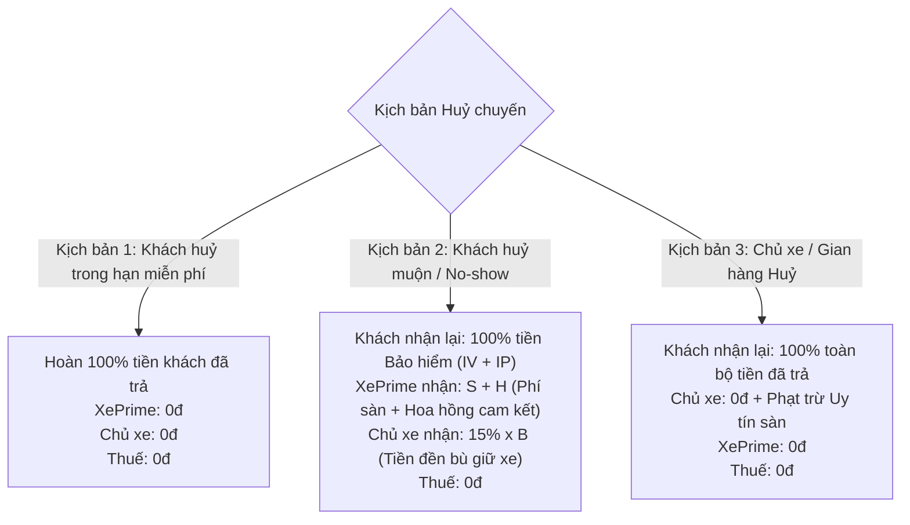

# TÀI LIỆU ĐẶC TẢ TÀI CHÍNH, TIỀN GIỮ CHỖ & MA TRẬN HOÀN HUỶ (FINANCIAL HOLD & REFUND SPEC)

| Thông tin tài liệu | Chi tiết |
| :--- | :--- |
| **Mã tài liệu** | `SPEC-BUS-03` |
| **Dự án** | XePrime Rental Platform |
| **Phiên bản** | `v3.0.0` |
| **Ngày ban hành** | 22/10/2026 |
| **Module liên quan** | `fee-policies`, `holds`, `wallets`, `tax`, `insurance` |

---

## 1. CÔNG THỨC TÍNH TIỀN GIỮ CHỖ ONLINE (QR SEPAY)

Khoản tiền khách quét mã QR SePay để xác nhận đặt xe được xác định theo công thức bảo toàn:

$\text{grossOnline} = S + H + (IV + IP) + \text{roundVnd}(15\% \times B)$

*(Đúng tới đồng — ADR 0069; trước 22/10/2026 phần 15% được làm tròn 1.000đ.)*

*Trong đó:*
* $B$: Tiền thuê xe sau khuyến mãi của xe (không gồm phí giao xe $G$).
* $S$: Phí sàn cố định phía khách ($50.000đ$ ô tô / $30.000đ$ xe máy).
* $H$: Hoa hồng lũy tiến của XePrime (tính theo số ngày thuê; tuyến gói $H = 0$).
* $IV$: Bảo hiểm vật chất xe theo ngày ($50.000đ$/ngày ô tô, $15.000đ$/ngày xe máy — chỉ tính khi khách chọn).
* $IP$: Bảo hiểm tai nạn người theo ngày ($20.000đ$/ngày ô tô, $5.000đ$/ngày xe máy — chỉ tính khi khách chọn).
* $15\% \times B$: **Phần cam kết giữ chỗ bảo đảm thuộc về Chủ xe**.

### Điều kiện kẹp sàn và trần bảo vệ (Safety Clamps)
$$\text{grossOnline} = \min\Big(B + S + IV + IP,\ \max\big(\text{grossOnline},\ S + H + IV + IP + T,\ \text{holdMinAmount}\big)\Big)$$
- **Sàn không-phải-tiền-chủ-xe ($S + H + IV + IP + T$):** Bảo đảm phần tiền thuộc về chủ xe $D \ge T$, ví chủ xe không bao giờ bị số âm.
- **Trần $B + S + IV + IP$:** Ngăn chặn lỗi cấu hình khiến số tiền online vượt quá tổng giá trị chuyến xe.

---

## 2. MA TRẬN PHÂN BỔ HOÀN HUỶ 3 BÊN (REFUND & FORFEITURE MATRIX)

Khi có sự kiện huỷ chuyến, dòng tiền được phân bổ tự động theo bảng ma trận sau:

### Bảng chi tiết dòng tiền phân bổ:

| Dòng tiền | 1. Khách huỷ trong hạn miễn phí | 2. Khách huỷ muộn / No-show | 3. Chủ xe / Gian hàng huỷ |
| :--- | :---: | :---: | :---: |
| **Tiền bảo hiểm ($IV + IP$)** | Hoàn $100\%$ về ví khách | **Hoàn $100\%$ về ví khách** | Hoàn $100\%$ về ví khách |
| **Phí sàn XePrime ($S$)** | Hoàn $100\%$ về ví khách | **XePrime giữ lại** | Hoàn $100\%$ về ví khách |
| **Hoa hồng sàn ($H$)** | Hoàn $100\%$ về ví khách | **XePrime giữ lại** | Hoàn $100\%$ về ví khách |
| **Phần cọc chủ xe ($15\% \times B$)** | Hoàn $100\%$ về ví khách | **Ghi có vào Ví chủ xe** | Hoàn $100\%$ về ví khách |
| **Nghĩa vụ thuế ($T$)** | **Không phát sinh ($0đ$)** | **Không phát sinh ($0đ$)** | **Không phát sinh ($0đ$)** |
| **Chế tài xử phạt vi phạm** | Không phạt | Khách mất toàn bộ cọc giữ xe | Phạt trừ uy tín chủ xe + Tạm khóa xe 24h–48h |

---

## 3. NGUYÊN TẮC PHÁP LÝ BẮT BUỘC VỀ BẢO HIỂM VÀ THUẾ

### 3.1. Kỷ luật Bảo hiểm MIC ($IV$ và $IP$)
> [!IMPORTANT]
> **BẢO HIỂM LUÔN HOÀN 100% NẾU CHƯA NHẬN XE.**  
> Giấy chứng nhận bảo hiểm (GCN) chỉ được phát hành tại thời điểm bàn giao xe (`handover`). Do đó, nếu chuyến xe bị huỷ trước khi nhận xe (kể cả khách huỷ muộn):
> 1. Không có rủi ro bảo hiểm nào phát sinh.
> 2. XePrime không phải trả phí cho công ty bảo hiểm MIC.
> 3. Nền tảng **tuyệt đối không được giữ lại tiền bảo hiểm** làm doanh thu phạt. Toàn bộ tiền $IV + IP$ phải hoàn trả ngay cho khách.

### 3.2. Kỷ luật Thuế nhà nước ($T$)
> [!NOTE]
> Thuế GTGT và Thuế TNCN (tự lái 5% + 2% = 7%, có tài xế 3% + 1,5% = 4,5% — ADR 0068; doanh nghiệp không khấu trừ) chỉ phát sinh trên doanh thu dịch vụ cho thuê xe hoàn thành thực tế. Chuyến xe bị huỷ không tạo ra dịch vụ vận chuyển, do đó:
> 1. Cổng thuế ghi nhận $0đ$ nghĩa vụ thuế cho chuyến xe bị huỷ.
> 2. Khoản phạt huỷ chuyến $15\% \times B$ ghi nhận vào ví chủ xe là khoản "Bồi thường vi phạm hợp đồng", hạch toán theo quy định thu nhập bồi thường dân sự.

---

## 4. VÍ DỤ PHÂN BỔ DÒNG TIỀN CỤ THỂ (BENCHMARK SCENARIO)

*Kịch bản:* Ô tô thuê 5 ngày $\times$ 1.000.000đ/ngày.
* $B = 5.000.000đ$
* $S = 50.000đ$ (cố định ô tô)
* $H = (2 \times 1.000.000 \times 10\%) + (3 \times 1.000.000 \times 7\%) = 200k + 210k = 410.000đ$
* $IV = 5 \times 50.000đ = 250.000đ$
* $15\% \times B = 15\% \times 5.000.000đ = 750.000đ$
* Thuế $T = (5\% + 2\%) \times B = 250.000 + 100.000 = 350.000đ$ (chủ xe cá nhân, tự lái — ghi sổ khi chuyến bắt đầu, trừ khi chuyến xong)
* Phí giao xe tận nơi $G = 200.000đ$ (khách trả tay lúc nhận xe)

$$\begin{aligned}
\text{Tổng khách trả cả chuyến} &= 5.000.000 + 50.000 + 250.000 + 200.000 = \mathbf{5.500.000đ} \\
\text{Tiền giữ chỗ QR} &= 50.000 + 410.000 + 250.000 + 750.000 = \mathbf{1.460.000đ} \\
\text{Khách trả tay khi nhận xe} &= 5.500.000 - 1.460.000 = \mathbf{4.040.000đ} \text{ (gồm 200k tiền giao xe)}
\end{aligned}$$

### Bảng đối soát khi có sự kiện huỷ:

| Kịch bản | Khách nhận lại | XePrime nhận | Ví chủ xe ghi có |
| :--- | :---: | :---: | :---: |
| **Khách huỷ sớm (trong hạn)** | **1.460.000đ** | 0đ | 0đ |
| **Khách huỷ muộn / No-show** | **250.000đ** *(tiền bảo hiểm IV)* | **460.000đ** *($S + H$)* | **750.000đ** *($15\% \times B$)* |
| **Chủ xe huỷ chuyến** | **1.460.000đ** | 0đ | 0đ *(bị trừ điểm uy tín)* |
| **Chuyến xe hoàn thành bình thường** | — | **460.000đ** | **4.440.000đ** *(thuê thuần $B - H - T + G$ = 5.000.000 − 410.000 − 350.000 + 200.000)* |

*Kiểm tra bảo toàn dòng tiền:*
Khách huỷ muộn: Số tiền khách nộp $1.460.000đ = 250.000đ \text{ (hoàn khách)} + 460.000đ \text{ (XePrime)} + 750.000đ \text{ (Chủ xe)}$ $\rightarrow$ **Cân bằng tuyệt đối $\pm 0đ$**.

