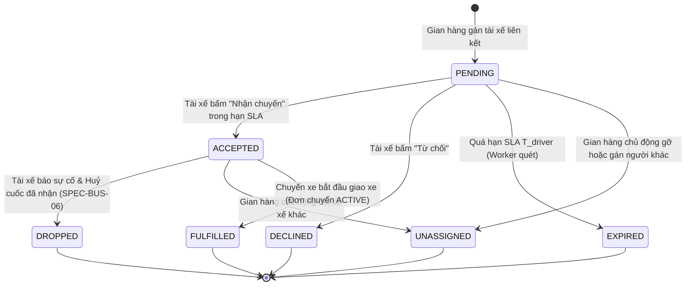
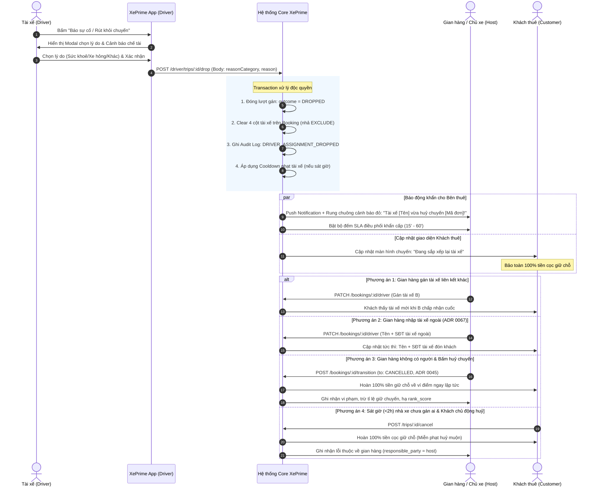

# TÀI LIỆU ĐẶC TẢ NGHIỆP VỤ: TÀI XẾ HỦY CHUYẾN ĐÃ NHẬN & ĐIỀU PHỐI 3 BÊN (DRIVER DROP ACCEPTED TRIP SPECIFICATION)

| Thông tin tài liệu | Chi tiết |
| :--- | :--- |
| **Mã tài liệu** | `SPEC-BUS-06` |
| **Dự án** | XePrime Rental Platform |
| **Phiên bản** | `v1.0.0` — Ban hành chính thức ngày 26/10/2026 |
| **Vai trò soạn thảo** | Senior Business Analyst (BA) |
| **Tài liệu căn cứ** | ADR 0045 (Huỷ chuyến & Uy tín), ADR 0063 (Tài xế liên kết), ADR 0064 & 0066 (SLA động & Lưới chống treo đơn), ADR 0067 (Tài xế ngoài hệ thống), SPEC-BUS-02, SPEC-BUS-03 |
| **Phân hệ liên quan** | `drivers`, `bookings`, `booking-driver-assignments`, `customer-trips`, `holds`, `notifications`, `audit` |

---

## 1. BỐI CẢNH DỰ ÁN & VẤN ĐỀ NGHIỆP VỤ (BUSINESS PROBLEM STATEMENT)

### 1.1. Hiện trạng hệ thống (As-Is)
1. **Phân định quyền hạn theo ADR 0063:** Tài xế trong hệ thống XePrime là tài khoản Khách (realm `customer`) được bên thuê mời liên kết. Tài xế chỉ thao tác trên **LƯỢT GÁN (`booking_driver_assignments`)** của chính mình, tuyệt đối **không có quyền đổi trạng thái ĐƠN THUÊ (`bookings`)**, không bàn giao xe và không huỷ đơn của khách.
2. **Quy tắc cam kết của ADR 0063:** Một khi tài xế đã bấm **"Nhận chuyến" (`accepted`)**, hệ thống xem đây là cam kết ràng buộc thực hiện dịch vụ. Hệ thống chặn tài xế tự ý huỷ cuốc hoặc tự ý rời gian hàng (`leave` bị chặn bởi lỗi `DRIVER_HAS_ACCEPTED_TRIPS`).
3. **Quy tắc chống tự huỷ của ADR 0067:** Chuyến thiếu tài xế sát giờ **KHÔNG tự động huỷ đơn**, bảo vệ tối đa hợp đồng thuê xe của khách và nguồn thu của nhà xe.

### 1.2. Vấn đề thực tế nảy sinh (The Pain Point)
Trong thực tế đời sống vận hành xe dịch vụ, tài xế sau khi nhận cuốc có thể gặp các sự cố bất khả kháng khẩn cấp:
- Sức khoẻ đột xuất (ốm đau, tai nạn, ngộ độc thực phẩm).
- Phương tiện hoặc thiết bị cá nhân gặp sự cố nghiêm trọng không thể khắc phục kịp thời.
- Việc gia đình khẩn cấp, thiên tai, sạt lở trên cung đường di chuyển tới điểm đón.

**Hậu quả nếu KHÔNG có tính năng huỷ nhận cuốc trên App:**
- Tài xế không có nút báo huỷ/xin rút sẽ buộc phải **"Bỏ rơi cuốc xe" (No-show tài xế)** trong im lặng hoặc chỉ gọi điện thoại bên ngoài.
- Đến giờ hẹn, khách thuê đứng chờ ngoài đường không có xe đón, gọi tài xế không nghe máy.
- Gian hàng/Chủ xe không nhận được tín hiệu cảnh báo trên phần mềm để kịp thời điều động xe hoặc tài xế khác.
- Gây khủng hoảng trải nghiệm khách hàng, khiếu nại gay gắt, thiệt hại uy tín toàn sàn XePrime.

### 1.3. Mục tiêu giải pháp (To-Be)
Xây dựng luồng **"Tài xế báo sự cố / Xin rút khỏi chuyến đã nhận" (Driver Drop / Cancel Accepted Assignment)** giải quyết hài hoà lợi ích và trách nhiệm của 3 bên:
1. **Khách thuê (Customer):** Không bị huỷ đơn đột ngột; được bảo toàn 100% tiền cọc giữ chỗ; được cập nhật minh bạch tiến độ điều phối tài xế mới; có nút chủ động huỷ hoàn tiền 100% nếu sát giờ nhà xe không điều được tài xế.
2. **Tài xế (Driver):** Có lối thoát danh chính ngôn thuận khi gặp sự cố bất khả kháng; ghi nhận lý do rõ ràng; chịu chế tài phân tầng theo thời gian huỷ (Lead Time) và tần suất vi phạm.
3. **Bên thuê / Chủ xe (Host):** Nhận cảnh báo động đỏ tức thì (Real-time Urgent Alert); có khung thời gian SLA rõ ràng để gán tài xế liên kết khác hoặc nhập tài xế ngoài hệ thống (theo ADR 0067); có đường huỷ đơn minh bạch khi hoàn toàn bất khả kháng (chấp nhận trừ uy tín theo ADR 0045).
4. **Nền tảng XePrime (Platform):** Quản lý an toàn tiền giữ chỗ (15% theo ADR 0066), kiểm soát bằng audit log, đảm bảo tính bất biến của dữ liệu.

---

## 2. NGUYÊN TẮC CỐT LÕI & CÁC BẤT BIẾN HỆ THỐNG (SYSTEM INVARIANTS)

1. **Bất biến 1 — Tài xế KHÔNG huỷ đơn của khách:** Hành động của tài xế là **huỷ cam kết lượt lái của cá nhân** (`cancel assignment`), hoàn toàn không làm chuyển trạng thái đơn thuê từ `reserved` sang `cancelled`. Đơn thuê vẫn thuộc về gian hàng và khách thuê.
2. **Bất biến 2 — Tiền giữ chỗ KHÔNG đổi chiều khi tài xế huỷ cuốc:** Toàn bộ tiền giữ chỗ 15% của khách vẫn được ký quỹ an toàn tại XePrime. Không ai bị trừ tiền hay phạt tiền ngay tại thời điểm tài xế bấm rút lui.
3. **Bất biến 3 — Trách nhiệm hợp đồng thuộc về Bên cho thuê (Host):** Gian hàng là đơn vị bán dịch vụ cho khách. Nếu sau khi tài xế rút lui mà gian hàng không bố trí được người thay thế dẫn đến chuyến đi không thể thực hiện, gian hàng là bên chịu trách nhiệm trước khách hàng theo chế tài của ADR 0045 (`responsible_party = host`, `counts_against_host = true`, hoàn 100% cọc cho khách).
4. **Bất biến 4 — Giải phóng lịch chống trùng ngay lập tức:** Ngay khi xác nhận rút khỏi chuyến, ràng buộc EXCLUDE chống trùng lịch (`bookings_driver_user_schedule_excl`) của tài xế đó tại chuyến này phải được giải phóng ở DB, cho phép tài xế không còn bị chiếm lịch (tuy nhiên chịu thời gian phạt Cooldown ở tầng ứng dụng nếu huỷ muộn).
5. **Bất biến 5 — Minh bạch thông tin với khách:** Khách chỉ thấy thông tin tài xế khi đã CHỐT (tài xế đã nhận hoặc tài xế ngoài). Khi tài xế rút, giao diện của khách trở về trạng thái "Đang sắp xếp tài xế", không để lộ danh tính người vừa huỷ hay mâu thuẫn nội bộ của nhà xe.

---

## 3. SƠ ĐỒ MÁY TRẠNG THÁI & QUY TRÌNH TOÀN TRÌNH (STATE MACHINE & FLOWCHARTS)

### 3.1. Sơ đồ trạng thái Lượt gán Tài xế (Driver Assignment State Machine)



### 3.2. Sơ đồ quy trình phối hợp 3 Bên khi Tài xế huỷ chuyến



---

## 4. MA TRẬN PHÂN VÙNG THỜI GIAN & SLA ĐIỀU PHỐI (DYNAMIC LEAD-TIME MATRIX)

Gọi $\Delta T_{\text{drop}} = \text{pickupAt} - \text{droppedAt}$ (Khoảng thời gian từ lúc tài xế bấm huỷ nhận cuốc đến giờ nhận xe đã hẹn).

| Vùng thời gian ($\Delta T_{\text{drop}}$) | Mức độ khẩn cấp | SLA gian hàng điều phối lại ($T_{\text{reassign}}$) | Chế tài áp dụng đối với Tài xế | Trải nghiệm & Quyền của Khách thuê |
| :--- | :---: | :---: | :--- | :--- |
| **VÙNG 1: Xa giờ đón**<br>$\Delta T_{\text{drop}} \ge 12\text{ giờ}$ | Thấp | **120 phút** | • Ghi nhận vi phạm nhẹ vào lịch sử hiệu suất.<br>• Không bị phạt Cooldown. | • UI chuyến: Hiển thị *"Đang sắp xếp tài xế"*.<br>• Không gửi thông báo tiêu cực.<br>• Khách an tâm theo dõi. |
| **VÙNG 2: Trong ngày**<br>$2\text{ giờ} \le \Delta T_{\text{drop}} < 12\text{ giờ}$ | Trung bình | **45 phút** | • Bị phạt Cooldown tạm ngắt nhận chuyến "Đặt ngay" trong **24 giờ**.<br>• Giảm ưu tiên trong thuật toán chia đơn `pickForAutoAssign`. | • UI chuyến: *"Đang điều phối lại tài xế"*.<br>• Nếu quá 45 phút chưa có tài xế mới: Khách được quyền bấm huỷ nhận hoàn 100% cọc. |
| **VÙNG 3: Sát giờ đón**<br>$\Delta T_{\text{drop}} < 2\text{ giờ}$ | **BÁO ĐỘNG ĐỎ (Critical)** | **15 phút** | • Bị phạt Cooldown tạm ngắt nhận chuyến "Đặt ngay" trong **48 giờ**.<br>• Hệ thống gắn cờ vi phạm nghiêm trọng để gian hàng xem xét đình chỉ (`SUSPENDED`). | • UI chuyến: Cảnh báo vàng *"Chuyến xe đang gặp sự cố điều phối"*, kèm hotline hỗ trợ.<br>• **Khách có nút huỷ khẩn cấp**: Hoàn 100% tiền cọc ngay lập tức.<br>• Khách có nút "Báo chưa nhận xe" khi quá giờ nhận (ADR 0066). |

---

## 5. ĐẶC TẢ YÊU CẦU CHỨC NĂNG CHI TIẾT (FUNCTIONAL SPECIFICATIONS)

### 5.1. UC-DRIVER-01: Tài xế báo sự cố & Rút khỏi chuyến đã nhận
* **Actor:** Tài xế liên kết (đang đăng nhập tài khoản Khách, realm `customer`).
* **Tiền điều kiện (Pre-conditions):**
  1. Đơn thuê có `serviceType = 'with_driver'`.
  2. Đơn thuê đang ở trạng thái `reserved` hoặc `confirmed` (chưa sang `active` / chưa giao xe).
  3. Lượt gán của tài xế đang ở trạng thái `driverAssignmentStatus = 'accepted'`.
  4. Người thực hiện là chính `driverUserId` của đơn.
* **Luồng sự kiện chính (Main Flow):**
  1. Tài xế truy cập tab *"Chuyến tôi lái"*, chọn chuyến xe cần rút lui.
  2. Bấm nút **"Báo sự cố / Rút khỏi chuyến"**.
  3. Hệ thống hiển thị Popup/Modal yêu cầu chọn lý do:
     - `HEALTH_ISSUE`: Vấn đề sức khỏe đột xuất.
     - `VEHICLE_ACCIDENT`: Xe cá nhân / phương tiện gặp tai nạn, hư hỏng.
     - `FAMILY_EMERGENCY`: Việc gia đình khẩn cấp.
     - `ROUTE_BLOCKED`: Thiên tai, đường sá bị phong tỏa không thể tiếp cận.
     - `OTHER`: Lý do khác (bắt buộc nhập ô lý do chi tiết từ 10 đến 500 ký tự).
  4. Hệ thống hiển thị cảnh báo chế tài tương ứng theo khoảng cách giờ đón ($\Delta T_{\text{drop}}$).
  5. Tài xế tích chọn cam kết và bấm **"Xác nhận rút khỏi chuyến"**.
  6. Hệ thống thực thi transaction DB khép kín (xem mục 8).
  7. Trả về thông báo thành công: *"Bạn đã rút khỏi chuyến xe. Lịch trình của bạn đã được giải phóng."*
* **Hậu điều kiện (Post-conditions):**
  - Chuyến xe chuyển sang danh sách lịch sử (hoặc biến khỏi danh sách chuyến sắp tới).
  - Khóa trùng lịch `bookings_driver_user_schedule_excl` của tài xế được nhả.
  - Áp dụng thời gian phạt Cooldown tương ứng nếu huỷ trong Vùng 2 hoặc Vùng 3.

### 5.2. UC-HOST-01: Gian hàng tiếp nhận cảnh báo khẩn & Điều phối thay thế
* **Actor:** Chủ gian hàng, Quản lý chi nhánh hoặc Nhân viên có quyền `booking.manage` / `driver.manage`.
* **Luồng sự kiện:**
  1. Ngay khi tài xế bấm rút cuốc, hệ thống kích hoạt chuông cảnh báo và gửi thông báo đẩy:
     - **Tiêu đề:** `🚨 KHẨN CẤP: Tài xế huỷ chuyến {bookingCode}`.
     - **Nội dung:** `Tài xế {driverName} vừa rút khỏi chuyến {bookingCode} đón lúc {pickupAt}. Lý do: {reasonText}. Vui lòng bổ sung tài xế trong vòng {SLA} phút!`
  2. Gian hàng mở chi tiết đơn hàng:
     - Huy hiệu trạng thái tài xế hiển thị màu cam: `Thiếu tài xế (Tài xế vừa huỷ)`.
     - Đồng hồ đếm ngược SLA hiển thị thời gian còn lại để gán người mới.
  3. **Lựa chọn điều phối của Gian hàng:**
     - **Lựa chọn 1 (Gán tài xế liên kết khác):** Bấm "Gán tài xế" $\rightarrow$ Chọn tài xế đang rảnh trong danh sách $\rightarrow$ Hệ thống gửi lượt gán mới với đồng hồ $T_{\text{driver}}$.
     - **Lựa chọn 2 (Gán tài xế ngoài hệ thống - ADR 0067):** Bấm "Nhập tài xế ngoài" $\rightarrow$ Nhập Tên (2-120 ký tự) + SĐT di động Việt Nam hợp lệ $\rightarrow$ Lưu thành công; đơn lập tức được coi là đã có tài xế, khách nhìn thấy tên và SĐT mới ngay lập tức.
     - **Lựa chọn 3 (Bất khả kháng - Bấm huỷ chuyến):** Nếu không thể tìm ra tài xế nào, gian hàng bấm "Huỷ chuyến do không có tài xế" $\rightarrow$ Khách được hoàn 100% tiền giữ chỗ, gian hàng chịu phạt theo ADR 0045.

### 5.3. UC-CUST-01: Trải nghiệm khách thuê & Quyền huỷ hoàn tiền 100% khi sát giờ
* **Actor:** Khách thuê xe (Customer).
* **Luồng sự kiện:**
  1. Khi tài xế rút cuốc, nếu $\Delta T_{\text{drop}} \ge 2\text{ giờ}$:
     - Khách không nhận thông báo đẩy gây hoang mang.
     - Tại màn hình *"Chuyến của tôi"*, khối tài xế hiển thị: *"Đang sắp xếp tài xế"* (giữ giao diện sạch, chuyên nghiệp).
  2. Nếu $\Delta T_{\text{drop}} < 2\text{ giờ}$ (Sát giờ đón) mà gian hàng chưa có người thay thế:
     - Màn hình chuyến hiển thị thẻ cảnh báo nổi bật: *"Nhà xe đang khẩn trương điều phối lại tài xế cho chuyến đi của bạn"*.
     - Hệ thống xuất hiện nút hành động bổ sung: **"Huỷ chuyến (Hoàn 100% cọc)"**.
  3. Nếu khách bấm huỷ lúc này:
     - Hệ thống áp dụng quy tắc miễn phạt huỷ muộn cho khách (bởi vì lỗi do nhà xe không đảm bảo tài xế đúng cam kết).
     - Toàn bộ tiền giữ chỗ 15% được hoàn trả $100\%$ ngay lập tức vào Ví điểm của khách.
     - Phía chịu trách nhiệm huỷ được server ghi nhận là `responsible_party = host` với lý do `driver_dropped_unfulfilled`.

### 5.4. UC-CUST-02: Khách báo "Chưa nhận được xe" khi quá giờ đón (ADR 0066 Lớp 1)
* **Luồng sự kiện:**
  - Nếu đến giờ nhận xe (`pickupAt`) mà không có tài xế nào đến đón và gian hàng cũng không liên hệ:
  - Trong khung cửa sổ $[ \text{pickupAt},\ \text{pickupAt} + 120\text{ phút} ]$, khách bấm nút đỏ **"Chưa nhận được xe"**.
  - Hệ thống tự động tạo Hồ sơ hỗ trợ tranh chấp khẩn cấp (`SupportCase`, loại `dispute`, mức ưu tiên `urgent`).
  - Toàn bộ tiền giữ chỗ của chuyến đi bị hoãn quyết toán (`hasOpenDispute = true`). Đội ngũ CSKH sàn XePrime lập tức can thiệp gọi điện cho cả 2 bên để bảo vệ quyền lợi của khách.

---

## 6. MA TRẬN TÀI CHÍNH & PHÂN BỔ TIỀN CỌC (FINANCIAL & REFUND MATRIX)

Tài liệu này kế thừa toàn bộ ma trận tài chính từ **SPEC-BUS-03** và **ADR 0066 / ADR 0068 / ADR 0069**:

| Kịch bản kết thúc chuyến | Tiền hoàn cho Khách thuê | Tiền chuyển vào Ví Chủ xe | Phí sàn & Hoa hồng XePrime ($S + H - P$) | Nghĩa vụ Thuế GTGT/TNCN |
| :--- | :--- | :--- | :--- | :--- |
| **1. Gian hàng điều phối tài xế mới thành công & chuyến đi hoàn tất** | $0đ$ (Khách thanh toán nốt phần còn lại cho tài xế) | Nhận doanh thu thuê xe thực tế sau khấu trừ | XePrime thu $S + H - P$ khi kết thúc chuyến | Khấu trừ 4,5% doanh thu theo ADR 0068 (nếu chủ xe là cá nhân) |
| **2. Gian hàng không có tài xế $\rightarrow$ Chủ động bấm huỷ đơn (ADR 0045)** | **Hoàn 100% tiền giữ chỗ** ($D + S + H + IV + IP - P$) vào Ví điểm | $0đ$ (Không phát sinh doanh thu hay bồi thường) | $0đ$ (XePrime không thu phí dịch vụ trên chuyến hỏng) | Thuế phát sinh = $0đ$ |
| **3. Sát giờ đón (<2h) chưa có người $\rightarrow$ Khách bấm huỷ do lỗi nhà xe** | **Hoàn 100% tiền giữ chỗ** vào Ví điểm ngay lập tức | $0đ$ | $0đ$ | Thuế phát sinh = $0đ$ |
| **4. Tranh chấp "Chưa nhận được xe" $\rightarrow$ Admin xác minh lỗi gian hàng** | **Hoàn 100% tiền giữ chỗ** vào Ví điểm + Tặng Voucher xin lỗi | $0đ$ (Gian hàng bị xử phạt cảnh cáo trên sàn) | $0đ$ | Thuế phát sinh = $0đ$ |

> [!NOTE]
> Mọi giao dịch hoàn tiền giữ chỗ do sự cố tài xế đều được chuyển thẳng vào **Ví điểm XePrime** của khách để có thể sử dụng ngay lập tức đặt xe khác hoặc rút về tài khoản ngân hàng, không qua cổng hoàn SePay chậm trễ.

---

## 7. QUY CHUẨN THÔNG BÁO & TRUYỀN THÔNG (NOTIFICATION MATRIX)

| Mã sự kiện | Đối tượng nhận | Kênh thông báo | Tiêu đề (Title) | Nội dung chi tiết (Body) |
| :--- | :--- | :--- | :--- | :--- |
| `NOTIF-DRV-01` | Gian hàng / Chủ xe | Push App + Chuông chuông Portal | `🚨 Khẩn cấp: Tài xế huỷ chuyến {code}` | `Tài xế {driverName} vừa huỷ chuyến {code} đón lúc {pickupTime}. Lý do: {reason}. Bổ sung tài xế trong {sla} phút!` |
| `NOTIF-DRV-02` | Tài xế huỷ cuốc | In-app Push | `Xác nhận rút khỏi chuyến {code}` | `Bạn đã rút khỏi chuyến {code}. Lưu ý: Tài khoản của bạn tạm ngắt nhận cuốc tự động trong {cooldownHours}h.` |
| `NOTIF-DRV-03` | Khách thuê (khi có tài xế mới) | Push App + SMS | `Đã phân công tài xế mới cho chuyến {code}` | `Chuyến đi {code} của bạn đã được chuyển giao cho tài xế {newDriverName} - SĐT: {newDriverPhone}. Chúc bạn chuyến đi thuận lợi!` |
| `NOTIF-DRV-04` | Khách thuê (khi sát giờ chưa có xe) | Push App | `Thông tin chuyến đi {code}` | `Nhà xe đang điều phối lại tài xế cho chuyến xe đón lúc {pickupTime}. Nhấn vào đây nếu bạn muốn huỷ nhận lại 100% tiền cọc.` |

---

## 8. THIẾT KẾ DỮ LIỆU KỸ THUẬT & API CONTRACTS (TECHNICAL SPECIFICATIONS)

### 8.1. Mở rộng Database Schema & Enums

#### Bổ sung Enum Outcome:
```prisma
enum DriverAssignmentOutcome {
  OPEN
  ACCEPTED
  DECLINED
  EXPIRED
  UNASSIGNED
  DROPPED       // <-- MỚI: Tài xế đã accept nhưng sau đó huỷ/rút khỏi chuyến
}
```

#### Bổ sung Enum Lý do huỷ của Tài xế:
```prisma
enum DriverDropReasonCategory {
  HEALTH_ISSUE
  VEHICLE_ACCIDENT
  FAMILY_EMERGENCY
  ROUTE_BLOCKED
  OTHER
}
```

#### Bổ sung trường Cooldown phạt tài xế trên bảng liên kết `drivers`:
```prisma
model Driver {
  // ... các trường hiện tại
  autoAssignCooldownUntil DateTime? // Mốc thời gian hết hạn phạt tạm dừng gán cuốc tự động
}
```

### 8.2. Đặc tả API Endpoint

#### `POST /driver/trips/:id/drop`
* **Xác thực:** Bearer Token, `@Realms(ACCOUNT_REALM.CUSTOMER)`.
* **Path Params:** `id: string` (Booking ID).
* **Request Body DTO:**
```typescript
export class DropAcceptedTripDto {
  @IsEnum(DriverDropReasonCategory)
  @ApiProperty({ enum: DriverDropReasonCategory, description: 'Nhóm lý do huỷ cuốc' })
  reasonCategory: DriverDropReasonCategory;

  @IsOptional()
  @IsString()
  @Length(10, 500)
  @ApiProperty({ description: 'Giải trình chi tiết (bắt buộc nếu chọn OTHER)' })
  reason?: string;
}
```
* **Mã lỗi phản hồi (Error Codes):**
  - `400 BAD_REQUEST`: Thiếu lý do hoặc giải trình dưới 10 ký tự khi chọn `OTHER`.
  - `404 NOT_FOUND`: Không tìm thấy chuyến đi tương ứng với tài xế này.
  - `409 CONFLICT` (`DRIVER_TRIP_NOT_ACCEPTED`): Chuyến đi chưa ở trạng thái `ACCEPTED` (đang pending hoặc đã hoàn thành).
  - `409 CONFLICT` (`DRIVER_ASSIGNMENT_LOCKED`): Đơn đã giao xe (`status = ACTIVE`) hoặc đã kết thúc — không được phép huỷ cuốc.

### 8.3. Xử lý Logic nghiệp vụ lõi (Transaction Script)
Toàn bộ quy trình rút cuốc của tài xế phải chạy trong **MỘT TRANSACTION DB DUY NHẤT** (`tx`):
1. Khóa dòng booking bằng `SELECT ... FOR UPDATE` (chống race condition).
2. Kiểm tra trạng thái đơn: `status IN ('reserved', 'confirmed')` và `driverAssignmentStatus === ACCEPTED`.
3. Đóng bản ghi `booking_driver_assignments` hiện tại:
   `outcome = DROPPED`, `endedAt = now()`, `endedBy = userId`, `dropReasonCategory`, `dropReason`.
4. Cập nhật `bookings`:
   `driverId = null`, `driverUserId = null`, `driverAssignmentStatus = null`, `driverAssignedAt = null`, `driverRespondedAt = null`, `driverRespondBy = null`.
5. Tính toán khoảng cách $\Delta T_{\text{drop}}$:
   - Nếu $\Delta T_{\text{drop}} < 12\text{h}$: Tính mốc `cooldownUntil = now() + 24h` (hoặc `48h` nếu $< 2\text{h}$). Cập nhật vào bảng `driver`.
6. Ghi nhật ký kiểm toán hệ thống (`audit_logs`):
   `action = 'booking.driver_drop_accepted'`, `targetType = 'booking'`, `actorScope = 'customer'`.
7. Gửi cảnh báo khẩn cấp tức thời tới toàn bộ thành viên của tenant gian hàng (`notifications.emitToTenantMembers`).

---

## 9. ĐIỀU KHOẢN CHUYỂN TIẾP & KIỂM THỬ CHẤP NHẬN (UAT CRITERIA)

1. **Tiêu chí UAT-01:** Tài xế huỷ cuốc xong không thể bấm nhận lại chính chuyến đó trừ khi gian hàng gán lại.
2. **Tiêu chí UAT-02:** Ràng buộc chống trùng lịch DB (`EXCLUDE`) nhả ngay lập tức, tài xế không còn bị kẹt lịch bận.
3. **Tiêu chí UAT-03:** Khách thuê truy cập app không thấy màn hình lỗi, không bị trừ cọc, thấy trạng thái "Đang sắp xếp tài xế".
4. **Tiêu chí UAT-04:** Gian hàng nhận ngay thông báo đẩy khẩn cấp có đầy đủ mã đơn, giờ nhận, tên tài xế và lý do.
5. **Tiêu chí UAT-05:** Nếu sát giờ (<2h), khách bấm nút "Huỷ chuyến do sự cố tài xế", tiền giữ chỗ hoàn 100% vào ví điểm trong vòng dưới 1 giây.
