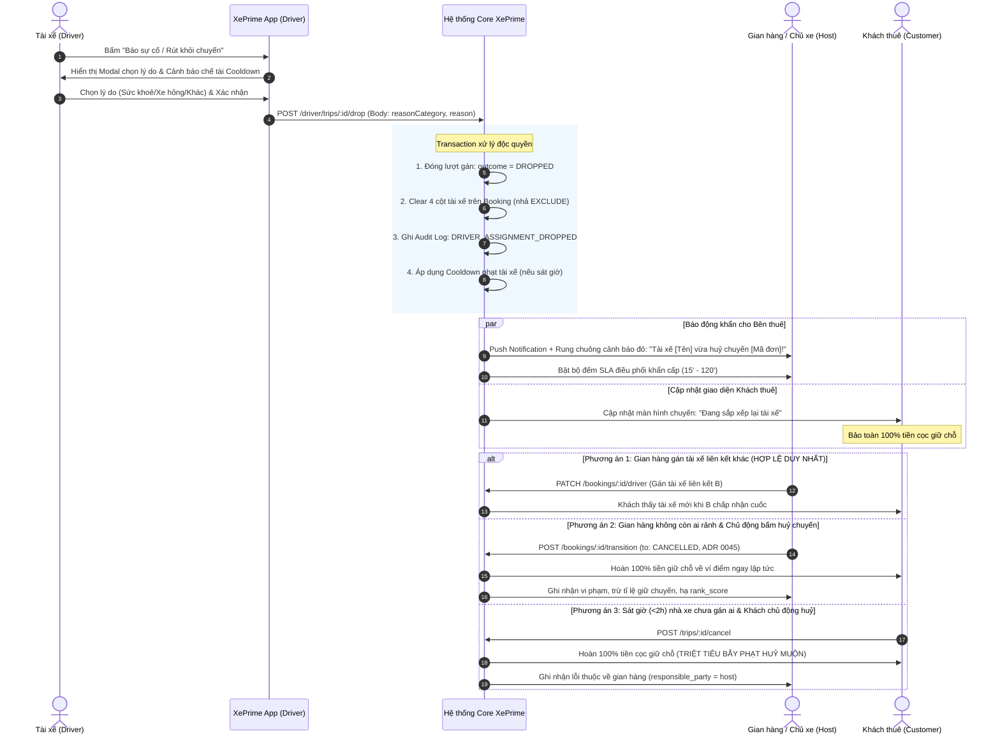

# TÀI LIỆU ĐẶC TẢ NGHIỆP VỤ: TÀI XẾ HỦY CHUYẾN ĐÃ NHẬN & ĐIỀU PHỐI 3 BÊN
## DRIVER DROP ACCEPTED TRIP SPECIFICATION (STRICT LINKED DRIVERS ONLY)

| Thông tin tài liệu | Chi tiết |
| :--- | :--- |
| **Mã tài liệu** | `SPEC-BUS-06` |
| **Dự án** | XePrime Rental Platform |
| **Phiên bản** | `v1.1.0` — Cập nhật ngày 26/10/2026: **Loại bỏ tài xế ngoài hệ thống; Bổ sung đánh giá & tối ưu luồng hoàn tiền** |
| **Vai trò soạn thảo** | Senior Business Analyst (BA) |
| **Tài liệu căn cứ** | ADR 0045 (Huỷ chuyến & Uy tín), ADR 0063 (Tài xế liên kết), ADR 0066 (SLA động & Lưới chống treo đơn), SPEC-BUS-02, SPEC-BUS-03 |
| **Phân hệ liên quan** | `drivers`, `bookings`, `booking-driver-assignments`, `customer-trips`, `holds`, `wallet`, `notifications`, `audit` |

---

## 1. BỐI CẢNH DỰ ÁN & VẤN ĐỀ NGHIỆP VỤ (BUSINESS PROBLEM STATEMENT)

### 1.1. Hiện trạng hệ thống (As-Is)
1. **Phân định quyền hạn theo ADR 0063:** Tài xế trong hệ thống XePrime là tài khoản Khách (realm `customer`) được bên thuê mời liên kết. Tài xế chỉ thao tác trên **LƯỢT GÁN (`booking_driver_assignments`)** của chính mình, tuyệt đối **không có quyền đổi trạng thái ĐƠN THUÊ (`bookings`)**, không bàn giao xe và không huỷ đơn của khách.
2. **Quy tắc cam kết của ADR 0063:** Một khi tài xế đã bấm **"Nhận chuyến" (`accepted`)**, hệ thống xem đây là cam kết ràng buộc thực hiện dịch vụ. Hệ thống chặn tài xế tự ý huỷ cuốc hoặc tự ý rời gian hàng (`leave` bị chặn bởi lỗi `DRIVER_HAS_ACCEPTED_TRIPS`).
3. **Quy tắc chống tự huỷ của ADR 0067:** Chuyến thiếu tài xế sát giờ **KHÔNG tự động huỷ đơn**, bảo vệ tối đa hợp đồng thuê xe của khách và nguồn thu của nhà xe.

### 1.2. Vấn đề thực tế nảy sinh (The Pain Point)
Trong thực tế đời sống vận hành xe dịch vụ, tài xế sau khi nhận cuốc có thể gặp các sự cố bất khả kháng khẩn cấp:
- Sức khoẻ đột xuất (ốm đau, tai nạn, ngộ độc thực phẩm).
- Phương tiện hoặc thiết bị cá nhân gặp sự cố nghiêm trọng không thể khắc phục kịp thời.
- Việc gia đình khẩn cấp, thiên tai, sạt lở trên cung đường di chuyển tới điểm đón.

**Hậu quả nếu KHÔNG có tính năng huỷ nhận cuốc trên App:**
- Tài xế không có nút báo huỷ/xin rút sẽ buộc phải **"Bỏ rơi cuốc xe" (No-show tài xế)** trong im lặng hoặc chỉ gọi điện thoại bên ngoài.
- Đến giờ hẹn, khách thuê đứng chờ ngoài đường không có xe đón, gọi tài xế không nghe máy.
- Gian hàng/Chủ xe không nhận được tín hiệu cảnh báo trên phần mềm để kịp thời điều động xe hoặc tài xế khác.
- Gây khủng hoảng trải nghiệm khách hàng, khiếu nại gay gắt, thiệt hại uy tín toàn sàn XePrime.

### 1.3. Mục tiêu giải pháp (To-Be)
Xây dựng luồng **"Tài xế báo sự cố / Xin rút khỏi chuyến đã nhận" (Driver Drop / Cancel Accepted Assignment)** giải quyết hài hoà lợi ích và trách nhiệm của 3 bên:
1. **Khách thuê (Customer):** Không bị huỷ đơn đột ngột; được bảo toàn 100% tiền cọc giữ chỗ; được cập nhật minh bạch tiến độ điều phối tài xế mới; có nút chủ động huỷ hoàn tiền 100% nếu sát giờ nhà xe không điều được tài xế.
2. **Tài xế (Driver):** Có lối thoát danh chính ngôn thuận khi gặp sự cố bất khả kháng; ghi nhận lý do rõ ràng; chịu chế tài phân tầng theo thời gian huỷ (Lead Time) và tần suất vi phạm.
3. **Bên thuê / Chủ xe (Host):** Nhận cảnh báo động đỏ tức thì (Real-time Urgent Alert); có khung thời gian SLA rõ ràng để gán tài xế liên kết khác; có đường huỷ đơn minh bạch khi hoàn toàn bất khả kháng (chấp nhận trừ uy tín theo ADR 0045).
4. **Nền tảng XePrime (Platform):** Quản lý an toàn tiền giữ chỗ (15% theo ADR 0066), kiểm soát bằng audit log, đảm bảo tính bất biến của dữ liệu.

---

## 2. NGUYÊN TẮC CỐT LÕI & CÁC BẤT BIẾN HỆ THỐNG (SYSTEM INVARIANTS)

1. **Bất biến 1 — CHÍNH THỨC LOẠI BỎ TÀI XẾ NGOÀI HỆ THỐNG (Strictly Linked Drivers Only):**
   * Theo quyết định phê duyệt ngày 26/10/2026, **bỏ hoàn toàn phương án cho nhập tài xế ngoài hệ thống** (không nhận Tên + SĐT rời).
   * Mọi tài xế thực hiện chuyến đi bắt buộc phải là **Tài xế liên kết (Linked Driver)** có tài khoản XePrime, đã xác minh SĐT, CCCD và bằng lái hợp lệ theo ADR 0063.
2. **Bất biến 2 — Tài xế KHÔNG huỷ đơn của khách:** Hành động của tài xế là **huỷ cam kết lượt lái của cá nhân** (`cancel assignment`), hoàn toàn không làm chuyển trạng thái đơn thuê từ `reserved` sang `cancelled`. Đơn thuê vẫn thuộc về gian hàng và khách thuê.
3. **Bất biến 3 — Tiền giữ chỗ KHÔNG đổi chiều khi tài xế huỷ cuốc:** Toàn bộ tiền giữ chỗ 15% của khách vẫn được ký quỹ an toàn tại XePrime. Không ai bị trừ tiền hay phạt tiền ngay tại thời điểm tài xế bấm rút lui.
4. **Bất biến 4 — Trách nhiệm hợp đồng thuộc về Bên cho thuê (Host):** Gian hàng là đơn vị bán dịch vụ cho khách. Nếu sau khi tài xế rút lui mà gian hàng không bố trí được tài xế liên kết khác dẫn đến chuyến đi không thể thực hiện, gian hàng là bên chịu trách nhiệm trước khách hàng theo chế tài của ADR 0045 (`responsible_party = host`, `counts_against_host = true`, hoàn 100% cọc cho khách).
5. **Bất biến 5 — Giải phóng lịch chống trùng ngay lập tức:** Ngay khi xác nhận rút khỏi chuyến, ràng buộc EXCLUDE chống trùng lịch (`bookings_driver_user_schedule_excl`) của tài xế đó tại chuyến này phải được giải phóng ở DB, cho phép tài xế không còn bị chiếm lịch (tuy nhiên chịu thời gian phạt Cooldown ở tầng ứng dụng nếu huỷ muộn).
6. **Bất biến 6 — Minh bạch thông tin với khách:** Khách chỉ thấy thông tin tài xế khi đã CHỐT. Khi tài xế rút, giao diện của khách trở về trạng thái "Đang sắp xếp tài xế", không để lộ danh tính người vừa huỷ hay mâu thuẫn nội bộ của nhà xe.

---

## 3. SƠ ĐỒ MÁY TRẠNG THÁI & QUY TRÌNH TOÀN TRÌNH

### 3.1. Sơ đồ trạng thái Lượt gán Tài xế (Driver Assignment State Machine)

### 3.2. Sơ đồ quy trình phối hợp 3 Bên khi Tài xế huỷ chuyến (Chỉ dùng Tài xế liên kết)

---

## 4. ĐÁNH GIÁ CHUYÊN SÂU TÍNH ỔN ĐỊNH CỦA LUỒNG HOÀN TIỀN HỦY CHUYẾN

### 4.1. Đánh giá tính ổn định hiện tại: Luồng tiền có ổn không?
**KẾT LUẬN TỔNG QUAN: LUỒNG TIỀN NỀN TẢNG ĐANG RẤT ỔN ĐỊNH VÀ AN TOÀN**, nhưng **CÓ 1 LỖ HỔNG NGHIỆP VỤ BẪY PHẠT KHÁCH CẦN ĐƯỢC CHẶN NGAY**:

#### A. Những điểm mạnh đã được bảo chứng (Rất ổn):
1. **Tiền ký quỹ an toàn:** Toàn bộ tiền giữ chỗ 15% ($D = 15\% \times B$) và phí dịch vụ $S + H - P$ đang được giữ tại tài khoản ký quỹ của XePrime, **chưa từng được chuyển cho chủ xe hay tài xế**. Do đó, hoàn toàn không có rủi ro bị chủ xe/tài xế ôm tiền bỏ trốn.
2. **Tốc độ hoàn tiền tức thì (Sub-second):** Tiền được hoàn vào **Ví điểm XePrime** của khách trong vòng chưa đầy 1 giây, không qua SePay đối soát thủ công chậm trễ.
3. **Nghĩa vụ thuế = 0đ:** Đúng theo quy định của Tổng cục Thuế và ADR 0068, dịch vụ vận tải chưa phát sinh nên không sinh nghĩa vụ thuế GTGT hay TNCN.

#### B. Những lỗ hổng / Điểm bất ổn cần khắc phục triệt để:
1. **LỖ HỔNG LỚN NHẤT — BẪY PHẠT HUỶ MUỘN ĐỐI VỚI KHÁCH HÀNG:**
   * *Thực trạng:* Theo ADR 0064 & ADR 0066, khách có mốc $T_{\text{cancel}} = \text{clamp}(20\% \Delta T, 15', 120')$. Sau mốc này, nếu khách huỷ, hệ thống sẽ **phạt mất cọc 15% đền cho chủ xe**!
   * *Bất cập:* Khi tài xế huỷ chuyến sát giờ (< 2h), mốc $T_{\text{cancel}}$ của khách thực tế đã qua từ lâu. Nếu khách thấy nhà xe không có tài xế và sốt ruột bấm nút "Huỷ chuyến", server nếu dùng hàm cũ sẽ **phạt trừ tiền cọc 15% của khách** và cộng vào ví chủ xe! Khách vừa bị trễ chuyến, vừa bị mất tiền oan.
   * *Giải pháp khắc phục:* **Bổ sung cờ miễn phạt:** Khi đơn đang ở trạng thái trống tài xế do tài xế cũ `DROPPED` và khoảng cách giờ đón $< 2\text{h}$ hoặc đã quá hạn SLA điều phối của gian hàng, hành động huỷ của khách được phân loại là `CUSTOMER_CANCEL_DRIVER_FAULT`. **Hệ thống bắt buộc hoàn trả 100% tiền giữ chỗ, miễn toàn bộ phí phạt.**
2. **Thanh khoản rút tiền mặt về tài khoản ngân hàng:**
   * Tiền hoàn vào Ví điểm dùng đặt chuyến xe khác rất tốt. Tuy nhiên, nếu khách không còn nhu cầu đặt xe nữa và muốn rút về tài khoản ngân hàng, hệ thống phải gắn cờ giao dịch `REFUND_DRIVER_INCIDENT` để **miễn 100% phí rút tiền** và duyệt tự động trong vòng 15 phút.
3. **Chính sách Voucher đền bù (Customer Apology):**
   * Khách đặt xe có tài xế thường có việc quan trọng (sân bay, hội nghị). Việc tài xế huỷ cuốc sát giờ gây tổn thất phi tài chính rất lớn. Hệ thống tự động cấp **01 Voucher 100.000đ** cho khách trên chuyến sau.

---

## 5. MA TRẬN PHÂN VÙNG THỜI GIAN & SLA ĐIỀU PHỐI (DYNAMIC LEAD-TIME MATRIX)

Gọi $\Delta T_{\text{drop}} = \text{pickupAt} - \text{droppedAt}$ (Khoảng thời gian từ lúc tài xế bấm huỷ nhận cuốc đến giờ nhận xe đã hẹn).

| Vùng thời gian ($\Delta T_{\text{drop}}$) | Mức độ khẩn cấp | SLA Gian hàng điều phối lại ($T_{\text{reassign}}$) | Chế tài áp dụng đối với Tài xế | Trải nghiệm & Quyền của Khách thuê |
| :--- | :---: | :---: | :--- | :--- |
| **VÙNG 1: Xa giờ đón** $\Delta T_{\text{drop}} \ge 12\text{ giờ}$ | Thấp | **120 phút** | • Ghi nhận vi phạm nhẹ vào lịch sử hiệu suất. • Không bị phạt Cooldown. | • UI chuyến: Hiển thị *"Đang sắp xếp tài xế"*. • Không gửi thông báo tiêu cực. • Khách an tâm theo dõi. |
| **VÙNG 2: Trong ngày** $2\text{ giờ} \le \Delta T_{\text{drop}} < 12\text{ giờ}$ | Trung bình | **45 phút** | • Bị phạt Cooldown tạm ngắt nhận chuyến "Đặt ngay" trong **24 giờ**. • Giảm ưu tiên trong thuật toán chia đơn `pickForAutoAssign`. | • UI chuyến: *"Đang điều phối lại tài xế"*. • Nếu quá 45 phút chưa có tài xế mới: Khách được quyền bấm huỷ nhận hoàn 100% cọc. |
| **VÙNG 3: Sát giờ đón** $\Delta T_{\text{drop}} < 2\text{ giờ}$ | **BÁO ĐỘNG ĐỎ (Critical)** | **15 phút** | • Bị phạt Cooldown tạm ngắt nhận chuyến "Đặt ngay" trong **48 giờ**. • Hệ thống gắn cờ vi phạm nghiêm trọng để gian hàng xem xét đình chỉ (`SUSPENDED`). | • UI chuyến: Cảnh báo vàng *"Chuyến xe đang gặp sự cố điều phối"*, kèm hotline hỗ trợ. • **Khách có nút huỷ khẩn cấp**: Hoàn 100% tiền cọc ngay lập tức. • Khách có nút "Báo chưa nhận xe" khi quá giờ nhận (ADR 0066). |

---

## 6. ĐẶC TẢ YÊU CẦU CHỨC NĂNG CHI TIẾT (FUNCTIONAL SPECIFICATIONS)

### 6.1. UC-DRIVER-01: Tài xế báo sự cố & Rút khỏi chuyến đã nhận
* **Actor:** Tài xế liên kết (đang đăng nhập tài khoản Khách, realm `customer`).
* **Tiền điều kiện:**
  1. Đơn thuê có `serviceType = 'with_driver'`.
  2. Đơn thuê đang ở trạng thái `reserved` hoặc `confirmed` (chưa sang `active` / chưa giao xe).
  3. Lượt gán của tài xế đang ở trạng thái `driverAssignmentStatus = 'accepted'`.
  4. Người thực hiện là chính `driverUserId` của đơn.
* **Luồng sự kiện chính:**
  1. Tài xế truy cập tab *"Chuyến tôi lái"*, chọn chuyến xe cần rút lui.
  2. Bấm nút **"Báo sự cố / Rút khỏi chuyến"**.
  3. Chọn nhóm lý do: `HEALTH_ISSUE`, `VEHICLE_ACCIDENT`, `FAMILY_EMERGENCY`, `ROUTE_BLOCKED`, `OTHER` (bắt buộc nhập từ 10 đến 500 ký tự).
  4. Hệ thống hiển thị cảnh báo mức phạt Cooldown tương ứng với khoảng cách giờ đón.
  5. Tài xế xác nhận $\rightarrow$ Transaction DB thực thi: Đóng lượt gán (`DROPPED`), xoá 4 cột tài xế trên đơn, nhả ràng buộc trùng lịch `EXCLUDE`, ghi Audit Log.

### 6.2. UC-HOST-01: Gian hàng gán tài xế liên kết thay thế (Phương án duy nhất)
* **Actor:** Quản lý gian hàng / Chủ xe.
* **Luồng sự kiện:**
  1. Nhận Push Notification khẩn cấp: *"🚨 KHẨN CẤP: Tài xế {driverName} vừa huỷ chuyến {code}!"*.
  2. Gian hàng mở chi tiết đơn $\rightarrow$ Bấm **"Gán tài xế"**.
  3. Danh sách hiển thị **chỉ các tài xế liên kết** (`linkStatus = ACTIVE`) đang rảnh lịch.
  4. Chọn tài xế B $\rightarrow$ Hệ thống gửi lượt gán mới với đồng hồ SLA $T_{\text{driver}}$.
  5. **Chặn hoàn toàn hành vi nhập tài xế ngoài hệ thống:** Mọi request chứa dữ liệu tài xế ngoài đều bị từ chối với mã lỗi `EXTERNAL_DRIVER_NOT_SUPPORTED`.

### 6.3. UC-HOST-02: Gian hàng không có người thay thế $\rightarrow$ Chủ động bấm huỷ đơn (ADR 0045)
* **Luồng sự kiện:**
  1. Gian hàng kiểm tra thấy toàn bộ tài xế liên kết đều bận, không thể bố trí người chạy chuyến.
  2. Chủ shop bấm **"Huỷ chuyến do thiếu tài xế"**.
  3. Hệ thống chuyển đơn sang `cancelled`:
     - Khách nhận hoàn đủ 100% tiền giữ chỗ vào Ví điểm.
     - Gian hàng bị ghi nhận vi phạm vào `booking_cancellations` với `responsible_party = host`, `counts_against_host = true`, bị trừ điểm uy tín và hạ `rank_score`.

### 6.4. UC-CUST-01: Khách thuê huỷ miễn phạt 100% khi sát giờ (< 2 giờ)
* **Luồng sự kiện:**
  1. Chuyến xe còn dưới 2 giờ tới giờ đón mà gian hàng chưa gán được tài xế mới.
  2. Khách mở chi tiết chuyến $\rightarrow$ Thấy nút đỏ **"Huỷ chuyến (Hoàn 100% cọc)"**.
  3. Khách bấm nút huỷ $\rightarrow$ Hệ thống nhận diện lỗi thuộc về nhà xe $\rightarrow$ Hoàn ngay 100% cọc vào Ví điểm của khách, không áp dụng phạt huỷ muộn.

---

## 7. ĐẶC TẢ KỸ THUẬT & API CONTRACTS

### 7.1. Database Schema
* Enum `DriverAssignmentOutcome`: thêm `DROPPED`.
* Enum `DriverDropReasonCategory`: `HEALTH_ISSUE`, `VEHICLE_ACCIDENT`, `FAMILY_EMERGENCY`, `ROUTE_BLOCKED`, `OTHER`.
* Model `Driver`: thêm trường `autoAssignCooldownUntil DateTime?`.

### 7.2. API Endpoints
* `POST /driver/trips/:id/drop`: Tài xế gọi rút cuốc (Body: `{ reasonCategory, reason }`).
* `PATCH /bookings/:id/driver`: Gán tài xế liên kết. **Từ chối (422)** nếu có trường `externalDriverName` hoặc `externalDriverPhone`.
